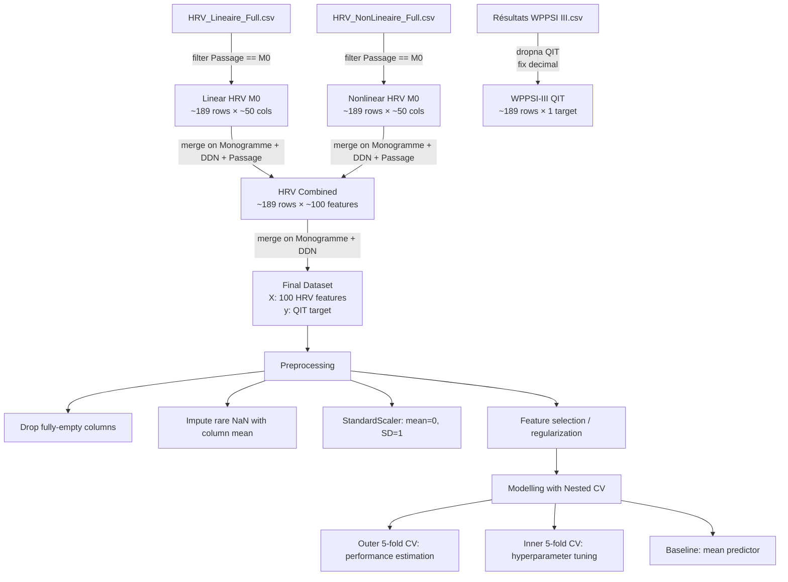

# Dataset description — PRI 2026 (AuBE cohort)

**Project:** Regression of Full-Scale IQ (FSIQ / QIT, WPPSI-III) in preschool children
from neonatal ECG recordings and heart-rate variability (HRV)

**Cohort:** AuBE (Saint-Étienne hospital), ~180–185 children with neonatal ECG and
preschool-age WPPSI-III assessment

**Files:** three CSVs at ``data/``:
- `HRV_Lineaire_Full.csv`
- `HRV_NonLineaire_Full.csv`
- `Résultats WPPSI III.csv`

---
## 1. HRV_Lineaire_Full.csv — Linear HRV indices

**What it contains:** Linear (time-domain, frequency-domain, geometric) HRV indices
computed from neonatal ECG recordings. These indices quantify heart-rate variability:
amplitude of RR-interval fluctuations, short-term vagal modulation (RMSSD, pNNx),
spectral power in VLF/LF/HF bands, histogram-based geometric indices, etc.

**Structure:** one row per recording passage. Each child may have several passages
(M0 = birth, M6, M12, M18, M24). For this project only **M0 (birth)** recordings are used
(as per Rapport.md §5.1).

**Columns (selected):**
| Column | Meaning |
|---|---|
| Numéro | Child index in the file |
| Monogramme | Child identifier (3-letter code, e.g. GAL, JOG) |
| DDN | Date of birth (DD/MM/YYYY) |
| Sexe | M/F |
| Tabac, Diabète, HTA, … | Perinatal/medical flags (0/1) |
| Passage | Recording age: M0 / M3 / M6 / M9 / M12 / M18 / M24 |
| Date | Recording date |
| Recorder | EDF or Novacor Vista device |
| Total duration | Recording duration |
| nb RR total / analyzed / excluded / corrected | RR-interval counts |
| Mean RR (TD24h), Mean HR (TD24h) | Time-domain mean RR / heart rate |
| SDNN (TD24h), RMSSD (TD24h) | Global and short-term variability |
| NN20 / NN30 / NN50, pcNN20 / pcNN30 / pcNN50 | Counts and % of successive RR differences > threshold |
| SDANN, SDNNIDX | Long- and short-term variance components |
| Ptot, VLF, LF, HF (FT24h / FTDay / FTNight) | Spectral power in frequency bands |
| LFnu, HFnu, LF/HF | Normalized powers and sympatho-vagal ratio |
| Tri ind, TINN, X, Y, N, M (GI24h / GIDay / GINight) | Geometric / histogram indices |
| TIpsd, VLFIpsd, LFIpsd, HFIpsd (IncNight) | Wavelet-based night indices |

**Notes:** The file contains a units row (row 2 in the raw file: ms, bpm, %, ms², …) that
must be skipped when loading. Some columns are fully empty for certain passages and
should be dropped before modelling. Numeric columns use `.` as decimal separator.

---

## 2. HRV_NonLineaire_Full.csv — Nonlinear HRV indices

**What it contains:** Nonlinear HRV indices computed from the same neonatal ECG
recordings. These explore the complexity, regularity, and scale-invariant properties of
the RR-interval series (Poincaré plot, detrended fluctuation analysis, entropy,
fractal dimension, fragmentation, etc.).

**Structure:** one row per recording passage, same row/child granularity as the linear
file. Only M0 recordings are used for this project.

**Columns (selected):**
| Column | Meaning |
|---|---|
| Monogramme, DDN, Sexe, … | Same identifiers and flags as the linear file |
| Passage | Recording age (M0, M6, …) |
| SD1 (PCP24h), SD2 (PCP24h) | Poincaré plot short- and long-term variability |
| SD1/SD2 (PCP24h) | Ratio of short- to long-term variability |
| alpha1 (DFA24h), alpha2 (DFA24h) | DFA scaling exponents (short / long term) |
| H (DFA24h) | Hurst exponent |
| Higuchi (24h), Katz (24h), Hurst (24h) | Fractal dimensions |
| Skewness (MT24h), Kurtosis (MT24h) | Distribution shape |
| Lyapunov (LLE24h) | Maximal Lyapunov exponent (chaos / sensitivity) |
| AppEn (Entropy24h), SampEn (Entropy24h) | Approximate / sample entropy (regularity) |
| SE, CE, CCE, NCCE (Entropy24h) | Shannon / conditional / corrected entropies |
| LZC (Entropy24h) | Lempel-Ziv complexity |
| 0V, 1V, 2LV, 2UV (Symb24h) | Symbolic / variation-vector counts |
| PIP, IALS, PSS, PAS | Fragmentation indices |
| AC, DC (ACDC24h) | Acceleration / deceleration capacity |
| … (same families repeated for Day and Night windows) | — |

**Notes:** Same loading caveats as the linear file (skip units row, drop fully-empty
columns). Contains the same set of children/passages as `HRV_Lineaire_Full.csv`, so the
two can be merged on `Monogramme` + `DDN` + `Passage`.

---

## 3. Résultats WPPSI III.csv — WPPSI-III IQ scores

**What it contains:** Preschool cognitive assessment results from the Wechsler Preschool
and Primary Scale of Intelligence, Third Edition (WPPSI-III), administered around age 3.
Scores are standardized (mean 100, SD 15 in the reference population). The target
variable for regression is **QIT** (quotient intellectuel total / Full-Scale IQ).

**Structure:** one row per child (unique by `Monogramme` + `DDN`). Some children have no
WPPSI score (lost to follow-up → empty row).

**Columns (selected):**
| Column | Meaning |
|---|---|
| N° | Child index |
| Monogramme | Child identifier (matches HRV files) |
| DDN | Date of birth (matches HRV files) |
| Age | Age at assessment |
| COM, INF, DIM, CUB, AOB | Subtest raw/scaled scores (verbal & performance) |
| QIV | Verbal IQ |
| QIP | Performance IQ |
| **QIT** | **Full-Scale IQ (target variable)** |
| NCL | Percentile rank |
| QIV / QIP / QIT / NCL (×3) | Confidence-interval bounds (lower / estimate / upper) |

**Notes:** The raw file has two header rows; use `header=1` (second row = column names)
and `skiprows`/`sep="\t"` as needed. Cells use `,` as decimal separator in some entries
(e.g. `0,5`, `99,6`) — replace with `.` before casting to numeric. Rows with missing QIT
must be excluded from the regression analysis.

---

## 4. How the files relate

| Link | Keys |
|---|---|
| HRV linear ↔ WPPSI-III | `Monogramme` + `DDN` |
| HRV nonlinear ↔ WPPSI-III | `Monogramme` + `DDN` |
| HRV linear ↔ HRV nonlinear | `Monogramme` + `DDN` + `Passage` |

**Merge result (M0 only):** ~189 children with both neonatal HRV features and a valid QIT
score. This is the analysis sample for the regression models.

---

## 5. Data quality & preprocessing notes (from Rapport.md §5.2)

- Missing HRV values are rare; they were imputed with the column mean to retain the
  small sample.
- Fully-empty feature columns (all NaN) should be dropped before modelling.
- HRV variables are standardized (mean 0, SD 1) for scale-sensitive models.
- QIT is kept as a continuous variable (primary analysis); a binary classification at the
  QIT < 90 threshold is a secondary, exploratory analysis.
- Sample size (n ≈ 180–185) is small relative to the number of features (~100), so
  feature selection, regularization, and nested cross-validation are essential to avoid
  overfitting (Rapport.md §5.3).

---

## 7. How datasets merge — End-to-end pipeline

### Step-by-step merge logic

| Step | Operation | Code snippet |
|------|-----------|--------------|
| 1 | Load linear HRV, skip units row | `pd.read_csv(..., skiprows=[1])` |
| 2 | Load nonlinear HRV, skip units row | `pd.read_csv(..., skiprows=[1])` |
| 3 | Load WPPSI-III, header row 1, tab-sep | `pd.read_csv(..., header=1, sep="\t")` |
| 4 | Fix decimal separator in WPPSI | `.replace({",": "."}, regex=True)` |
| 5 | Filter both HRV to `Passage == "M0"` | `df[df["Passage"] == "M0"]` |
| 6 | Drop rows with missing QIT | `wp.dropna(subset=["QIT"])` |
| 7 | Merge linear + nonlinear on `Monogramme` + `DDN` + `Passage` | `merge(..., on=["Monogramme","DDN","Passage"])` |
| 8 | Merge HRV + WPPSI on `Monogramme` + `DDN` | `merge(..., on=["Monogramme","DDN"])` |
| 9 | Drop fully-empty columns | `df.dropna(axis=1, how="all")` |
| 10 | Impute remaining NaN with column mean | `df.fillna(df.mean())` |
| 11 | Standardize features | `StandardScaler().fit_transform(X)` |

---

## 9. Quality
- MEAN (Mean Absolute Error)
- R²
	- **R² > 0** → model is better
	- **R² = 0** → same as the mean
	- **R² < 0** → model is worse than guessing the mean