# Predicting IQ at age 3 from neonatal HRV

*Group A · Jade · PRI 2026 · AuBE cohort (Saint-Étienne University Hospital)* · *Version française : [README_fr.md](README_fr.md)*

**Question**: do heart rate variability (HRV) indices recorded at birth help predict the IQ measured around age 3 (WPPSI-III), beyond clinical factors?

**Short answer**: no, with these data. No model does better than predicting the mean IQ, and the HRV indices tested explain **at most 6%** of the IQ variance. Yet the method is not blind: with the same data, it does recognise premature children (AUC 0.79: link demonstrated, acceptable discrimination).

**Status**: all analyses have been run on the real data, including the methods added after the teachers' feedback (step 11). The aggregated results are in [`results/en/`](results/en/) (French notebook: [`results/`](results/)); the numerical summary, with its generation date, is [`results/en/SUMMARY.md`](results/en/SUMMARY.md).

Contents: [1. Files](#1-files-in-this-folder) · [2. Running](#2-running-the-notebook) · [3. Reading the results](#3-reading-the-results-from-what-value-is-it-good) · [4. How it works](#4-how-it-works) · [5. What was done, step by step](#5-what-was-done-step-by-step) · [6. Reusing the code](#6-reusing-the-code) · [7. Pitfalls](#7-pitfalls-to-avoid) · [8. Picking up the work](#8-picking-up-the-work) · [9. Limitations](#9-limitations)

> The diagrams render on GitHub. In VS Code, install the "Markdown Preview Mermaid Support" extension.

---

## 1. Files in this folder

| File | Role |
|---|---|
| `01_prediction_qit_en.ipynb` | **the notebook to open**: every step and every result, in English |
| `01_prediction_qit.ipynb` | the same notebook in French (same computations, same numbers) |
| `outils_qit.py` | the technical code (reading, cleaning, models, plots), organised by notebook section. Function names are French, each with an English alias listed at the end of the file |
| `donnees_synthetiques.py` | creates **fake** data in the exact format of the real files, to try the notebook |
| `verifier_bornes.py` | checks the section 4.5 test on 8,000 simulated datasets (1 minute) |
| `corriger_hrv_nonlineaire.py` | fixes the 9 shifted rows of `HRV_NonLineaire_Full.csv` (already done, run once only) |
| `results/en/` | **aggregated** results of the English notebook: `SUMMARY.md` (with the table of all models), `settings_chosen_QIT.md`, plots (`results/` holds the French ones). `model_comparison.csv` is also written there but stays local, like every `.csv` in the repository |
| `docs/` | the explanatory figures of this document |

The data (`data/`) are never in git: they are children's health data, and the repository is public.

**What about `GroupA/clean_data.py`?** It is the team's cleaning script (formerly `data/pulisci_righe.py`). It writes cleaned copies to a `puliti/` folder and keeps only the birth recordings (M0). The notebook does not use it, because it also needs the recordings from 6 to 24 months (section 7, hypotheses): it reads the original files and applies the same principles (files linked by subject number, birth date as a check, children without all their scores removed). Since it reads the original files, the 9 shifted rows are fixed directly in them, by `corriger_hrv_nonlineaire.py` (step 4).

Target names keep the French codes of the data files: **QIT** = Full Scale IQ (FSIQ), **QIV** = Verbal IQ, **QIP** = Performance IQ, **NCL** = General Language Composite.

---

## 2. Running the notebook

**Installation** (once per computer, Python 3.14):

```powershell
cd FSIQ-from-ECG
py -3.14 -m venv .venv                     # Mac/Linux: python3.14 -m venv .venv
.venv\Scripts\Activate.ps1                 # Mac/Linux: source .venv/bin/activate
python -m pip install -r requirements.txt
nbstripout --install                       # clears notebook outputs at each commit: MANDATORY
```

`nbstripout --install` is not stored in the repository: run it again on **every new clone**. Without it, a commit would push the notebook outputs, including child-by-child plots, to the public repository.

**Data**: put `HRV_Lineaire_Full.csv`, `HRV_NonLineaire_Full.csv` and `Résultats WPPSI III.csv` in `data/`. No data? Set `SYNTHETIC_DATA = True` (section 6).

**Run**: open `01_prediction_qit_en.ipynb`, pick the `.venv` kernel, then *Run All*.

| Setting | Duration | Purpose |
|---|---|---|
| `QUICK = True` | about 5 minutes | check that everything runs (1 repeat) |
| `QUICK = False` | about 40 minutes | the results to report (10 repeats × 5 folds) |

---

## 3. Reading the results: from what value is it good

Every number in the notebook comes with its reading. The table gathers them.

| Measure (section) | What it is | Good value |
|---|---|---|
| **MAE** (4) | mean absolute error, in IQ points | lower than the MAE of the **mean baseline** (10.39 for FSIQ) |
| **Gain over the mean** [95% CI] (4) | MAE of the baseline − MAE of the model | **demonstrated only if the whole CI is above 0**; a positive gain whose CI contains 0 is not a result; whole CI below 0: worse than the mean |
| **R²** (4) | share of IQ variance explained, out of fold | > 0: better than the mean; 0: same; < 0: worse; 1: perfect |
| Strongest correlation vs chance (1.4) | strongest Spearman correlation with FSIQ, compared with shuffled IQs | a link exists only above the chance level (95th percentile) |
| Simulation (4.4) | gain on a fake IQ whose link with HRV is known | link detected when the whole CI is above 0 |
| **Spearman ρ, bound** (4.5) | correlation of a chosen index with FSIQ, simultaneous 95% CI | link demonstrated if the CI excludes 0; otherwise (CI bound)² = the largest share of variance compatible with the data |
| **AUC** (5, 6) | probability that the model ranks a positive child above a negative one | 0.5 = chance; **demonstrated if the CI low bound > 0.5**; 0.7–0.8 acceptable, 0.8–0.9 excellent, ≥ 0.9 outstanding |
| Balanced accuracy (6) | mean of sensitivity and specificity | 0.5 = chance |
| **Cohen's kappa** (6) | agreement beyond chance | 0 = chance; 0.2–0.4 fair; 0.4–0.6 moderate; > 0.6 substantial |
| Hypothesis (7) | gain over the mean with later HRV or HRV change | supported if the whole CI is above 0; whole CI below 0: worse than the mean; with 7 tests, a supported hypothesis would need confirming elsewhere |
| **Conformal interval** (8) | ± q points that contain the true FSIQ about 90% of the time | coverage ≈ 90% **and** narrower than the interval around the mean |
| Permutation importance (9) | drop in AUC when a variable is shuffled | > 0: the variable helps |
| **Impurity importance, SHAP** (9) | how much the tree relies on a variable | above the **chance threshold** (same ranking with IQ shuffled): shaded area of the plots |
| **Top-5 agreement** (9) | how much the top 5 variables overlap from one fold to another | above the chance threshold: stable ranking; otherwise do not interpret |
| **SHAP effect by quintile** (9) | change in the prediction from the lowest to the highest values of a variable | the effect matters if it leaves the grey zone (chance) |
| Multiple kernel weights (4.2) | weight given to clinical / linear HRV / non-linear HRV | a HRV weight of 0 means HRV does not help |

**Glossary**

- **HRV**: heart rate variability, computed from the ECG; indices such as RMSSD, SDNN, HF power.
- **M0, M6, … M24**: age in months at the recording; M0 = birth, the main analysis.
- **Fold, 10 × 5**: the children are split into 5 groups; each group is in turn the test group while the model learns on the other 4. This is repeated 10 times with different splits.
- **Training / test children**: the model learns only on the training children; it is judged only on the test children, whom it has never seen.
- **Mean baseline**: "predict the mean IQ of the training children for everyone". Any useful model must beat it.
- **Inner cross-validation**: a second split, inside the training children only, to choose a model's settings without ever touching the test children.
- **Leakage**: when information about the test children or the answer reaches the model; it makes results look much better than they are.
- **Positive control**: a question whose answer is known (HRV ↔ prematurity), asked to check that the method can see a link.
- **Chance threshold, shuffled IQ**: the same computation redone with IQs shuffled between children (no link at all); a real result must beat it.
- **SHAP**: for each child, how much each variable pushed the prediction up or down; the contributions add up exactly to the prediction.

---

## 4. How it works

```mermaid
flowchart LR
    A["3 CSV files<br/>linear HRV, non-linear HRV, WPPSI"] --> B["Cleaning<br/>never looks at IQ"]
    B --> C["Shared folds<br/>10 repeats × 5 folds<br/>folds.csv"]
    C --> S
    subgraph S ["Within each fold, on the training children only"]
        direction LR
        D["Gaps filled<br/>with the median"] --> E["One variable per group<br/>correlated above 0.95"] --> F["Normal distribution"] --> G["Selection<br/>all, forest, PCA, stepwise"] --> H["Model tuned<br/>by inner 5-fold CV"]
    end
    S --> I["Prediction of the<br/>test-fold children"]
    I --> J["evaluate_model.py<br/>MAE, R², gain over the mean, 95% CI"]
```

Each child is predicted by a model that has never seen it: not to learn, not to choose its variables, not to tune its hyperparameters. The code was developed and tested on synthetic data (`donnees_synthetiques.py`): the real data never leave `data/`.

### Model settings: default or not, and how they are found

*Requested by the teachers.* Everything not listed keeps the **default value** of its library (scikit-learn 1.9.1, LightGBM 4.7.0, XGBoost 3.4.1). Everything **tuned** is tuned by an inner 5-fold cross-validation, **on the training children only** of each fold. The notebook shows both tables below (section 3), computed directly from the code, and the settings **actually chosen** in each fold (section 4.2, `results/en/settings_chosen_QIT.md`).

| Model | Fixed (different from default) | Tuned (values tried) | How | Why these fixed values |
|---|---|---|---|---|
| Elastic Net | `max_iter=10000`, `selection="random"`, `random_state=0` | `alpha`: 30 values, from the one that zeroes everything to 100 times less; `l1_ratio` ∈ {0.1, 0.3, 0.5, 0.7, 0.9} | `ElasticNetCV`: all 150 combinations, MSE criterion | penalty path computed at once; `random` converges faster with correlated variables |
| Random Forest | `n_jobs=1`, `random_state=0` | `n_estimators` {200, 500}, `max_depth` {3, 5, 7, None}, `min_samples_leaf` {5, 10, 20}, `max_features` {sqrt, log2} | random search: 12 combinations out of 48, MAE criterion | parallelism over the folds; reproducible results |
| LightGBM | `colsample_bytree=0.5`, `subsample=0.8`, `subsample_freq=1`, `n_jobs=1`, `random_state=0` | `n_estimators` {100, 300}, `learning_rate` {0.01, 0.05, 0.1}, `max_depth` {3, 5, −1}, `min_child_samples` {10, 20}, `reg_alpha` {0, 0.1, 1}, `reg_lambda` {0, 1, 10} | random search: 12 out of 324, MAE criterion | each tree sees 50% of the variables and 80% of the children: less overfitting with ~150 children (fixed in advance) |
| XGBoost | `colsample_bytree=0.5`, `n_jobs=1`, `random_state=0` | `n_estimators` {100, 300}, `learning_rate` {0.01, 0.05, 0.1}, `max_depth` {3, 5, 7}, `min_child_weight` {1, 5}, `reg_alpha` {0, 0.1, 1}, `reg_lambda` {1, 10}, `subsample` {0.8, 1} | random search: 12 out of 432, MAE criterion | same reason as LightGBM |
| SVR | nothing | `rbf` kernel: `C` {0.1, 1, 10, 100}, `epsilon` {0.01, 0.1, 1}, `gamma` {scale, auto}; `linear` kernel: `C`, `epsilon` | random search: 12 out of 36, MAE criterion | defaults, except the tuned settings |
| Linear regression (with stepwise selection) | nothing | the variables (wrapper method) | added one at a time while the inner MAE drops by at least 0.1 point | no hyperparameter |
| Decision tree | `random_state=0` | `max_depth` {2, 3, 4, 5, None}, `min_samples_leaf` {5, 10, 20, 30} | full grid: 20 combinations, MAE criterion | reproducible results |
| Kernel ridge | IQ standardised within each fold | `rbf` and `laplacian` kernels: `alpha` {0.01 … 100}, `gamma` {0.001, 0.005, 0.01, 0.05}; `linear` kernel: `alpha` | full grid: 45 combinations, MAE criterion | kernel ridge has no intercept |
| Multiple kernel ridge | one Gaussian kernel per group, "scale" width; IQ centred | weights of the 3 groups (steps of 0.25, sum 1: 15 options), `alpha` {0.01, 0.1, 1, 10} | full grid: 60 combinations, MAE criterion | see step 11 |
| Logistic (sections 5 and 6) | `class_weight="balanced"`, `max_iter=5000`, inner 3-fold CV | `C`: 10 values from 10⁻⁴ to 10⁴ | `LogisticRegressionCV`, AUC criterion | the rare class counts as much |

**Random search or full grid?** The models of the week plan (Random Forest, LightGBM, XGBoost, SVR) are slow: a random search of 12 combinations usually finds a setting almost as good as a full grid, for much less computation. The models added later (tree, kernel ridge, multiple kernel) are fast: all combinations are tried.

**Preparation, selections, folds and analyses: fixed in advance, never tuned.** What differs from the scikit-learn defaults (everything else is default).

| Step | Object | Fixed (different from default) | Why |
|---|---|---|---|
| HRV: gaps | `SimpleImputer` | `strategy="median"` | the median resists extreme values better than the mean |
| HRV: redundant variables | `FiltreCorrelation` (written for the project) | `seuil=0.95` (threshold) | one variable per group correlated above 0.95 (Spearman) |
| HRV: normal distribution | `QuantileTransformer` | `n_quantiles=50`, `output_distribution="normal"` | suited to linear models; 50 quantiles because ~150 training children (the default, 1000, exceeds the number of children) |
| Clinical: gaps | `SimpleImputer` | `strategy="most_frequent"` | 0/1 covariates: the most frequent value stays 0 or 1 |
| Clinical: scaling | `StandardScaler` | nothing | |
| Selection `RF selection` | `SelectFromModel` | forest of 200 trees, `max_features="sqrt"`, `min_samples_leaf=5`; 30 variables (`threshold=-inf`) | the 30 most important variables of a regularised forest (supervisor's advice) |
| Selection `PCA 90%` | `PCA` | `n_components=0.9`, `svd_solver="full"` | keep 90% of the variance (supervisor's advice); exact computation |
| Selection `stepwise` (wrapper) | `SequentialFeatureSelector` | linear regression, `tol=0.1`, MAE criterion, inner 5-fold CV | stops when no variable lowers the MAE by at least 0.1 point |
| Inner CV (tuning) | `KFold` | `n_splits=5`, `shuffle=True`, `random_state=0` | same inner folds at each run |
| Evaluation folds (10 × 5) | `StratifiedKFold` | `n_splits=5`, `shuffle=True`, `random_state=42 + repeat` | stratified on FSIQ quintiles; identical folds at each run (`folds.csv`) |
| Variable ranking (9) | decision tree in `GridSearchCV` | prematurity: `class_weight="balanced"`, AUC criterion; FSIQ: same tree as in the evaluation; chance measured with 10 to 20 IQ shuffles | like the logistic model for prematurity |
| Permutation importance (9) | `permutation_importance` | `scoring="roc_auc"`, `random_state=0` | drop in AUC, the measure of the positive control |
| 95% CI of the gains (4, 7) | bootstrap (`evaluate_model.py`) | 2000 draws, seed 0 | children drawn with replacement, the same draws for all models |
| 95% CI of the AUC (5, 6) | bootstrap (`outils_qit.py`) | 2000 draws, seed 0 | same principle, on the predicted probability averaged over the repeats |
| CI of the bound (4.5) | Fisher transformation | Bonett–Wright standard error, Bonferroni over the indices | the bootstrap gave too many false links (6.3% instead of 5% at most); this one is checked on 8,000 simulated datasets (step 9) |

---

## 5. What was done, step by step

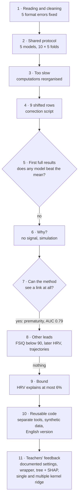

Each step: **what was done**, **the result**, and **what we learned** (which leads to the next step).

### Step 1 · Reading and cleaning the data

**What was done.** Read the 3 Excel exports and keep, for each child, one birth recording (M0), the HRV indices of both files, the clinical covariates and the 4 WPPSI scores.

**Result.** Five format problems had to be solved one after the other:

| Problem | Fix |
|---|---|
| ID column not found: Windows encoding, WPPSI header on 2 rows, unreadable accent "Num�ro" | column names compared without accents or case, "�" accepted as a wildcard |
| a **units row** (M/F, ms…) under the HRV header, read as a child | detected and skipped |
| `TypeError`: "-" cells in numeric columns | "", " ", "-", "NaN" become missing values |
| the birth visit written "MO" (letter O) instead of "M0" | visit names harmonised |
| children in the WPPSI file but missing from the HRV files | removed; files are linked by subject number, with the birth date as a check (initials repeat) |

Final dataset: **189 children**, 25 linear and 45 non-linear HRV indices (at M0, the linear file only has its 24h indices), 6 clinical covariates (4 too rare were removed).

**Learned.** Clean once, without looking at IQ, so nothing about the answer leaks into the cleaning.

### Step 2 · A shared protocol

**What was done.** Followed the week plan and the supervisor's advice: preparation within each fold, feature selection (random forest top 30, PCA 90%), 5 models (Elastic Net, Random Forest, LightGBM, XGBoost, SVR), **10 × 5 cross-validation** with the team's `evaluate_model.py`, conformal prediction and explanation.

**Learned.** Comparing models is only meaningful on the same children and the same folds: hence `cohort.csv` and `folds.csv`, in the format of `evaluate_model.py`, the team's shared evaluation tool. Any model evaluated on these two files is directly comparable with those of the notebook.

### Step 3 · Too slow

**Problem.** First runs took over 10 minutes in quick mode (1 repeat instead of 10): each combination of settings tried redid the whole variable preparation.

**What was done.** Elastic Net computes its whole penalty path at once (`ElasticNetCV`); for the slow models, a random search over 12 combinations replaces the full grid (choice explained in section 4).

**Result.** Full mode: about 25 minutes, then about 40 with the methods added in step 11.

### Step 4 · Nine shifted rows

**What was done.** Checking the files showed **9 rows** of `HRV_NonLineaire_Full.csv` shifted by 2 columns from column CB onwards (the "empty" end-of-row cells contained "-").

**Result.** `corriger_hrv_nonlineaire.py` fixes them: backs up the original, previews before writing, refuses to run twice.

**Learned.** A column shift raises no error: the values simply end up under the wrong index. The files must therefore be checked before any analysis. The team's `GroupA/clean_data.py` also repairs such rows, but in its own copies; since the notebook reads the original files, the fix is made in the file itself.

### Step 5 · First full results: nothing beats the mean

**What was done.** Full 10 × 5 run, 4 targets, 6 experiments.

**Result.**

| Target | Best model | MAE | MAE of the mean | Gain [95% CI] |
|---|---|---|---|---|
| QIT (full scale) | Elastic Net, clinical only | 10.33 | 10.39 | +0.06 [−0.12, 0.23] |
| QIV (verbal) | Elastic Net, clinical only | 11.68 | 11.66 | −0.02 [−0.22, 0.16] |
| QIP (performance) | Elastic Net, clinical only | 9.75 | 9.75 | +0.00 [−0.16, 0.17] |
| NCL (language) | Elastic Net, clinical only | 11.64 | 11.62 | −0.01 [−0.15, 0.13] |

No gain is demonstrated (every CI contains 0). Adding HRV to the clinical model does worse, slightly but demonstrably (FSIQ MAE from 10.33 to 10.47; gain over the mean −0.08 [−0.14, −0.02]). Tree-based models (Random Forest, LightGBM, XGBoost) do worse than the mean on average, for all 4 targets.

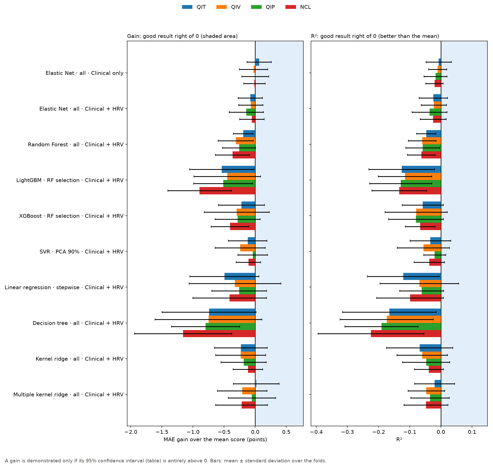

**Learned.** Before trying other models, understand why nothing works.

### Step 6 · Why? No signal

**What was done.** (a) Compared the strongest correlation between a variable and FSIQ with what chance gives. (b) Simulation: a fake IQ with a planted link of known strength (0 to 30% of variance), run through exactly the same method.

**Result.** The strongest correlation (0.16) is no stronger than with a random IQ (0.17 on average, up to 0.21). The method only detects a link from about **20% of explained variance**.

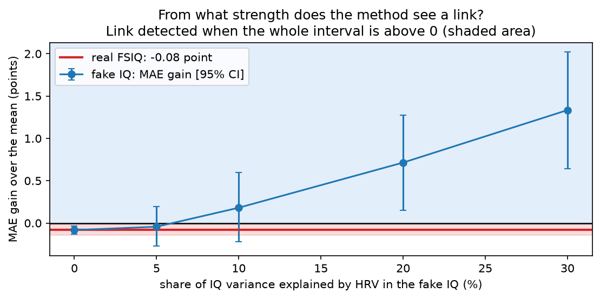

**Learned.** A weaker link (5 or 10%) could exist and go unnoticed: the method still had to be checked, and the link bounded more precisely (steps 7 and 9).

### Step 7 · Positive control: HRV does recognise prematurity

**What was done.** Asked the same method a question whose answer is known: guess prematurity from HRV alone.

**Result.** **AUC 0.79 [0.67, 0.93]**: link demonstrated, acceptable discrimination close to excellent.

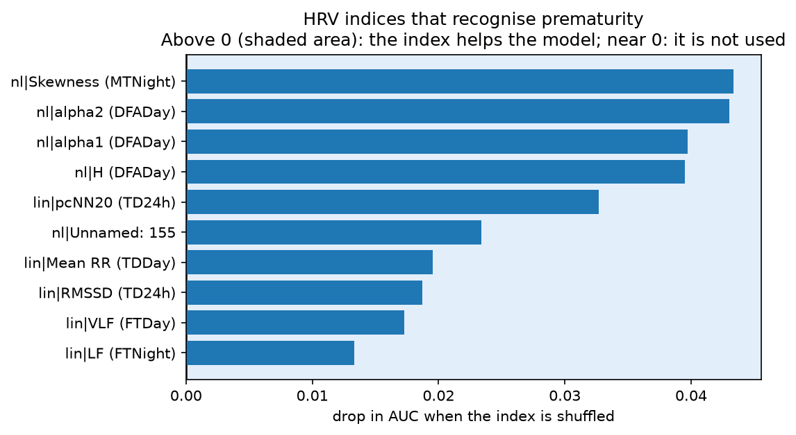

**Learned.** The data contain physiological information and the method can extract it: the absence of a link with IQ is a real result, not a data or code problem.

### Step 8 · Other leads

**What was done.** (a) Spot children with FSIQ < 90 (40 children) instead of predicting the score. (b) H1: HRV recorded later (M6 to M24). (c) H2: change in HRV between birth and 12 or 24 months.

**Result.** FSIQ < 90: AUC 0.50 [0.39, 0.61], like chance (kappa 0.00). H1 and H2: 7 hypotheses, none supported; two even do worse than the mean (HRV at birth: gain −0.13 [−0.22, −0.04]; HRV at 24 months: −0.14 [−0.24, −0.05]).

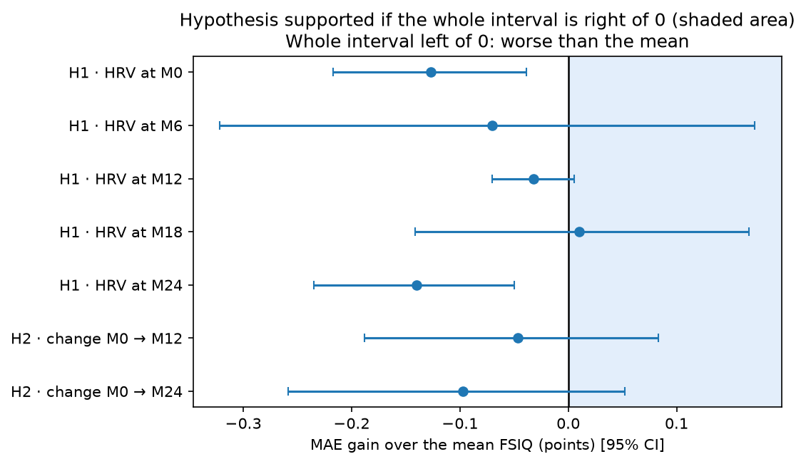

**Learned.** Neither a simpler question (low IQ or not), nor later HRV, nor its change over time reveals a link. Rather than adding more models, the next step was to quantify what this result rules out: what share of IQ could HRV explain, at most?

### Step 9 · Bound: HRV explains at most 6%

**What was done.** Instead of predicting with ~70 variables, test 4 indices chosen in advance from the literature (RMSSD, HF, SDNN at 24h, and the 1st principal component of all HRV), with simultaneous confidence intervals. A first version (bootstrap) reported too many false links (6.3% over 300 simulated datasets, instead of 5% at most); it was replaced by the Fisher interval, checked on 8,000 simulated datasets.

**Result.** No link demonstrated; none of these indices explains **more than 6%** of the FSIQ variance, before and after accounting for the clinical covariates. A 6% link would have been detected 8 times out of 10.

| Detection limits | Check of the test | Bounds |
|---|---|---|
| 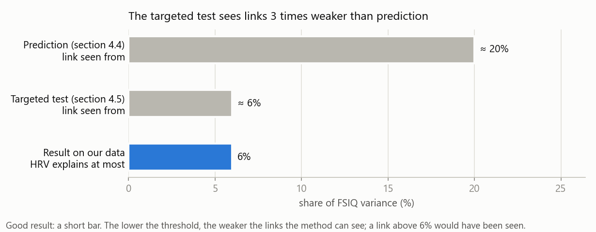 | 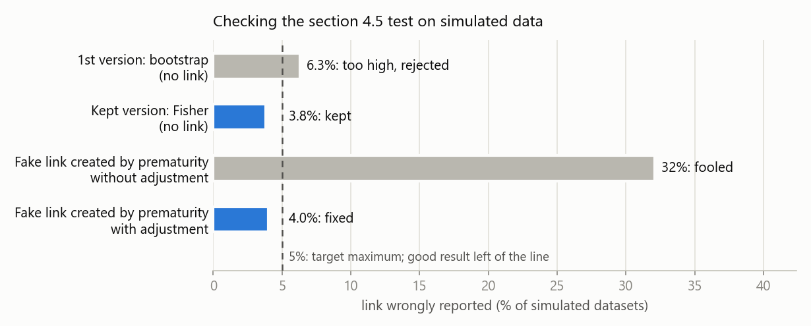 | 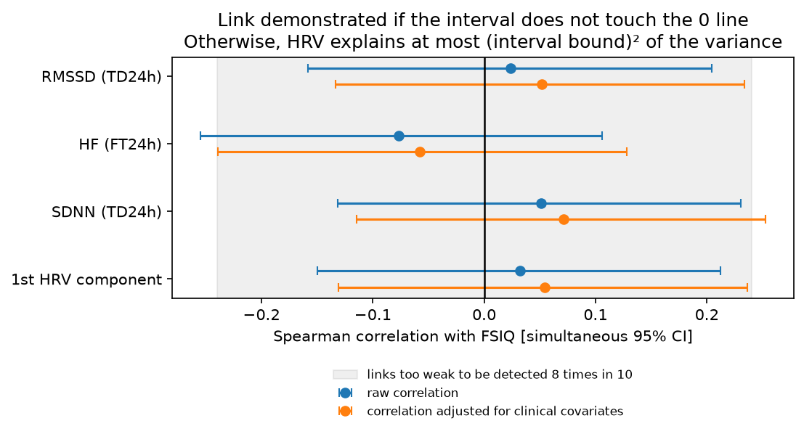 |

**Learned.** "We saw nothing" became "at most 6%", a much stronger statement.

### Step 10 · Making the code reusable

**What was done.** The technical code (reading, cleaning, models, plots) was moved out of the notebook into `outils_qit.py`, organised by section: the notebook now only shows the steps and the results. The methods did not change, and the numbers were checked identical before and after. So that others can pick up the work: an English version of the notebook (same computations, same numbers), a synthetic-data generator to try the code without the real data, a way to test any scikit-learn model with the same protocol (section 6), and the aggregated plots saved to `results/`.

**Result.** Library versions matter. In a fresh environment installed from `requirements.txt` (more recent versions than those used during development), Elastic Net, Random Forest, XGBoost and SVR give the same predictions, up to rounding errors; **LightGBM** does not (on the synthetic data, up to 12 points of difference for one child). LightGBM is never the best model: the conclusion is unchanged.

**Learned.** Versions are pinned in `requirements.txt`, and a result is only compared with another obtained with the same versions.

### Step 11 · Teachers' feedback

**What was done.**

| Request | What was done | Checks |
|---|---|---|
| Say whether the parameters are the defaults, otherwise which ones and how they were found | two automatic tables (section 4), settings chosen fold by fold | while checking, the **SVR grid had duplicates** (`gamma` is unused by the linear kernel: 12 of 48 combinations); split in two spaces. Only the SVR numbers change; all other models give exactly the same numbers |
| Try a **wrapper** method | **stepwise** forward selection with a linear regression, within each fold | number of variables kept and most chosen ones shown |
| **Decision tree** with **SHAP**, and with feature importance, to rank the variables | tree as a 10th model; ranking by impurity importance and by SHAP, with its **stability** and **chance thresholds** (same ranking with IQ shuffled); SHAP plots: beeswarm (individual, never saved) and **effect by quintile** (aggregated) | SHAP additivity checked (contributions + base = prediction) |
| **Kernel ridge regression** and **multiple kernel ridge regression** | kernel ridge with IQ standardised within each fold (no intercept); multiple kernel written for the project (`RidgeMultiNoyaux`): one Gaussian kernel per group (clinical, linear HRV, non-linear HRV), weights chosen by inner cross-validation | with a single group, it gives exactly scikit-learn's kernel ridge |

**Result** (FSIQ, 10 × 5 folds; details in [`results/en/SUMMARY.md`](results/en/SUMMARY.md)):

| Model (Clinical + HRV) | MAE | Gain over the mean [95% CI] | Reading |
|---|---|---|---|
| Linear regression, stepwise selection | 10.89 | −0.50 [−0.75, −0.24] | worse than the mean (whole CI below 0) |
| Decision tree | 11.14 | −0.74 [−1.03, −0.46] | worse than the mean |
| Kernel ridge | 10.62 | −0.23 [−0.37, −0.09] | worse than the mean |
| Multiple kernel ridge | 10.38 | +0.02 [−0.30, 0.32] | not demonstrated: on a par with the mean (10.39) |

- **Multiple kernel weights** (median over the 50 folds): clinical **1.00**, linear HRV **0.00**, non-linear HRV **0.00**. When it is allowed to choose, cross-validation **does not use HRV at all**: this is why this model matches the mean instead of doing worse.
- **Variable ranking** (chance thresholds: the same ranking redone with IQ, or prematurity, shuffled between children):
  - for FSIQ, no variable exceeds the chance threshold, and the top-5 agreement between folds (0.08) stays below the chance level (0.15): the ranking only describes noise;
  - for prematurity, two indices exceed the chance threshold, in importance as in SHAP: `nl|alpha2 (DFADay)`, a fractal index of daytime HRV, and `lin|pcNN20 (TD24h)`, the share of successive beats that differ by more than 20 ms (a marker of vagal tone). Their low values go with a higher probability of prematurity, but the mean effect by quintile stays within the chance zone, and the order of the following variables is no more stable than chance (agreement 0.22 versus 0.28). HRV therefore recognises prematurity (step 7), but a fine ranking of its indices is not reliable with 189 children.
- **SVR**: its numbers change slightly with the corrected grid (table of all models in `results/en/SUMMARY.md`); it stays worse than Elastic Net.
- Settings chosen fold by fold: [`results/en/settings_chosen_QIT.md`](results/en/settings_chosen_QIT.md).

**Learned.** Four more methods confirm the conclusion: none does better than the mean, three do worse, and the only model that could choose between clinical variables and HRV leaves HRV out.

| Ranking for FSIQ | Ranking for prematurity |
|---|---|
| 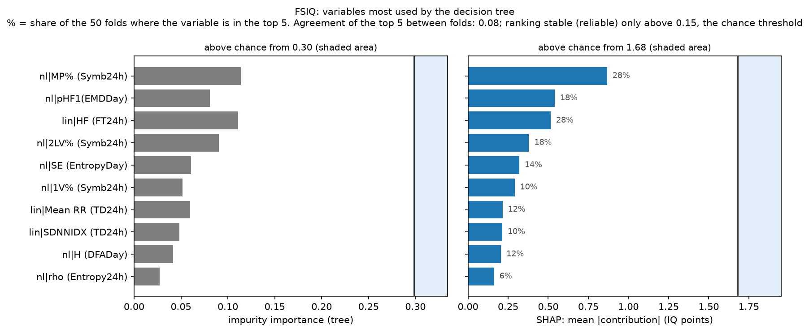 | 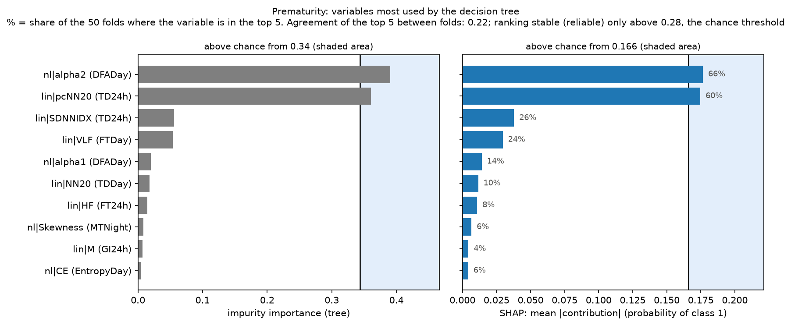 |

| SHAP effects for FSIQ | SHAP effects for prematurity |
|---|---|
| 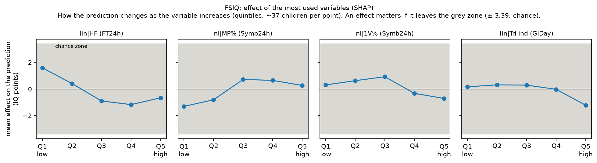 | 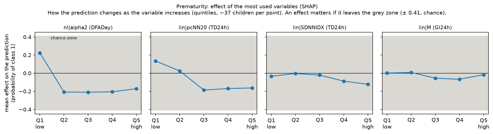 |

---

## 6. Reusing the code

### Trying it without the real data

In the notebook settings: `SYNTHETIC_DATA = True`. The notebook creates fake data in `data/synthetique/` (same columns, same format quirks as the real files, random values) and everything runs end to end. Results go to `data/synthetique/results/`: they do not overwrite the real ones, and the summary is marked "SYNTHETIC DATA". Two links are planted on purpose in these fake data (HRV → prematurity, strong; HRV → IQ, weak) so that the analyses have something to find.

### Testing your own model

Any scikit-learn model goes through exactly the same protocol as the others: same children, same folds, variable preparation redone within each fold, evaluation by `evaluate_model.py`. In section 3 of the notebook:

```python
from sklearn.linear_model import Ridge
CUSTOM_MODELS = {"Ridge": Ridge(alpha=10)}
EXPERIMENTS = [
    ("Elastic Net", "all", "Clinical only"),          # the clinical baseline, keep it
    ("Ridge", "all", "Clinical + HRV"),               # the new model
    # selections: "all", "RF selection", "PCA 90%", "stepwise"
    # feature sets: "Clinical only", "HRV only", "Clinical + HRV"
    # ready-made models: "Elastic Net", "Random Forest", "LightGBM", "XGBoost", "SVR", "Linear regression",
    #                    "Decision tree", "Kernel ridge", "Multiple kernel ridge"
]
```

The model is copied fresh into each fold. To tune its hyperparameters without leakage, pass an object that tunes itself (`RidgeCV`, `GridSearchCV(...)`, `RandomizedSearchCV(...)`).

### Adapting it to other data

The settings to change are marked `[TO ADAPT]` in the notebook and `[À ADAPTER]` at the top of `outils_qit.py`.

| I want… | Where | What to change |
|---|---|---|
| other files | notebook settings | `FILES` |
| other column names | top of `outils_qit.py` | `COL_ID_HRV`, `COL_ID_WPPSI`, `COL_PASSAGE`, `COLS_SCORES`, `COLS_CLINIQUES`, `MOTIFS_EXCLUS` (excluded patterns) |
| to predict other scores | notebook settings | `TARGETS` (among `COLS_SCORES`); sections 4.3 to 10 detail FSIQ |
| other cleaning or selection thresholds | top of `outils_qit.py` | `SEUIL_CORR` (correlation), `TOP_K`, `VARIANCE_PCA`, `TOL_PAS_A_PAS`, `MAX_MANQUANTS_COL` (missing values)… |
| other hyperparameters | `outils_qit.py` | `ESPACES` (also reachable as `tools.SEARCH_SPACES`) |
| more or fewer repeats | notebook settings | `T_REPEATS`, `K_FOLDS`, `N_ITER` |
| other indices for the bound (4.5) | notebook settings | `A_PRIORI_INDICES`, to be fixed **before** seeing the results |

### Using the tools in your own notebook

After a first run of the notebook, which creates `cohort.csv` and `folds.csv` in `data/cleaned/`:

```python
import sys
from pathlib import Path
ROOT = Path("../..").resolve()                       # the folder that contains evaluate_model.py
sys.path[:0] = [str(ROOT), str(ROOT / "GroupA" / "Jade")]
import outils_qit as tools
from evaluate_model import load_labels
from sklearn.linear_model import Ridge

tools.set_language("en")                             # English messages and tables
sources = tools.load_files(ROOT / "data", {"lin": "HRV_Lineaire_Full.csv", "nl": "HRV_NonLineaire_Full.csv",
                                           "wppsi": "Résultats WPPSI III.csv"})
data = tools.build_dataset(sources, "M0")                     # one recording per child, at birth
folds = tools.shared_folds(ROOT / "data" / "cleaned" / "folds.csv", range(1, 11))
y = load_labels(ROOT / "data" / "cleaned" / "cohort.csv", ["QIT"]).loc[data.index, "QIT"]
X = data.filter(regex=r"^(lin|nl|clin)\|")                    # HRV indices and clinical covariates
P = tools.cross_predictions(X, y, folds, Ridge(alpha=10))     # out-of-fold predictions
print(tools.gain_vs_mean(y, P, folds))                        # gain over the mean and its 95% CI
```

Every function has an explanation (`help(tools.cross_predictions)`, written in French) and an English name (list at the end of `outils_qit.py`).

### Three rules to keep

1. **Everything that learns happens within the folds**, on the training children only: imputation, selection, tuning, model. This is what `tools.build_pipeline` does; do not prepare the variables on all children before cross-validation.
2. **Never put the WPPSI scores (or their subtests) among the inputs**: they contain the answer (see [Pitfalls](#7-pitfalls-to-avoid)).
3. **Never save or share the individual-level plots** (sections 4.3 and 8, and the SHAP beeswarm of section 9). Only aggregated plots are saved to `results/`.

---

## 7. Pitfalls to avoid

- **Target leakage**: putting the WPPSI subtests, QIV or QIP among the variables to predict FSIQ gives an R² close to 1, because FSIQ is computed from them. A result that looks too good should prompt a search for leakage.
- **Choosing the variables on all children** before cross-validation: the test children "help" prepare the model, so the score is too optimistic.
- **Reporting the tuning score** (`best_score_` of a hyperparameter search) as the performance: it is optimistic by construction. Use nested cross-validation.
- **Accuracy with imbalanced classes**: with 79% of children above 90, always answering "≥ 90" gives 79% accuracy while knowing nothing. Look at the AUC, sensitivity, balanced accuracy and kappa instead.
- **Multiple comparisons**: out of 7 hypotheses, an isolated success may be due to chance.
- **Choosing the "a priori" indices of section 4.5 after the fact**: the test would lose its validity.
- **Trusting a variable ranking without its chance threshold and stability**: a tree always names a top variable, even when there is no signal.
- **A badly built search grid**: a parameter that only matters with one option (like `gamma` for the `rbf` kernel) creates duplicate combinations; use separate spaces. And a model without an intercept (kernel ridge) needs a centred IQ.
- **Identifiers**: initials and birth date are not enough (they repeat); link by subject number.
- **Empty cells** are written four ways in these files: nothing, a space, "-" or "NaN".
- **nbstripout** is not stored in the repository: run `nbstripout --install` on each clone, before the first commit.
- **Library versions**: install `requirements.txt` everywhere; LightGBM predictions can change from one version to another.

---

## 8. Picking up the work

**Where things stand**

| Done and solid | Not done yet |
|---|---|
| cleaning, shared protocol, 10 models, positive control, classification, hypotheses H1/H2, bound, conformal prediction, documented settings, methods requested by the teachers (wrapper, tree + SHAP with chance thresholds, single and multiple kernel ridge) | variables from the raw data (RR files, ECG signal): Group B's work; validation on another cohort |

**Possible next steps**, from the most to the least promising:
1. **Plug in Group B's variables** (from the raw RR / ECG data): add them as columns with their own prefix (for example `raw|`) in `build_dataset`, then as a new feature set in `FEATURE_SETS`; everything else (folds, models, evaluation, ranking) works unchanged, except the multiple kernel ridge, whose groups are fixed in `RidgeMultiNoyaux.GROUPES` (add the new prefix there, otherwise these variables are ignored by it).
2. **Confirm on another cohort** any link that would appear; with ~190 children, nothing can be confirmed internally.
3. **A non-linear dependence test** in section 4.5 (distance correlation with a permutation test), to rule out a U-shaped link that Spearman would miss; trees and RBF kernels already looked for non-linear links without finding any.
4. **Pure Lasso** (`l1_ratio = 1`): Elastic Net already tries very close mixes (`l1_ratio` up to 0.9) without beating the mean, so no different conclusion is expected; it is, however, the simplest test to add (a `LassoCV` in `CUSTOM_MODELS`, section 6).

**To know before modifying**: function names in `outils_qit.py` are French (English aliases at the end of the file); after modifying it, restart the notebook kernel; check any change on synthetic data first (`SYNTHETIC_DATA = True`); a full run takes about 40 minutes.

---

## 9. Limitations

- About 190 children, a single cohort, no external validation.
- IQ at age 3 depends on many things absent here (family environment, socio-economic status, events of the first years).
- Association is not causation: a predictive model does not say how to improve a child's IQ.
