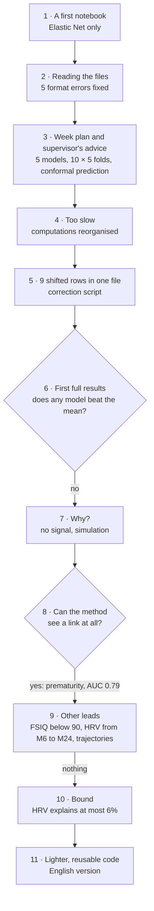
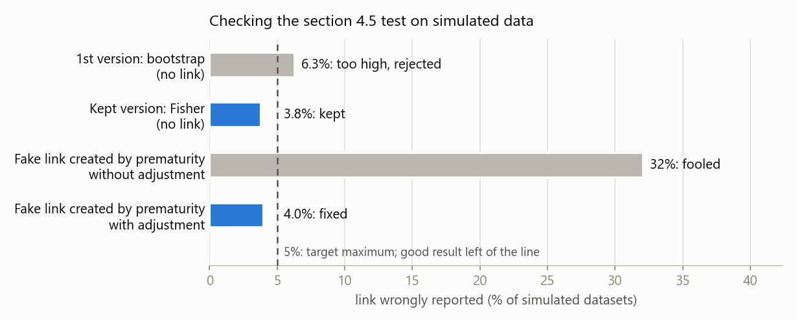
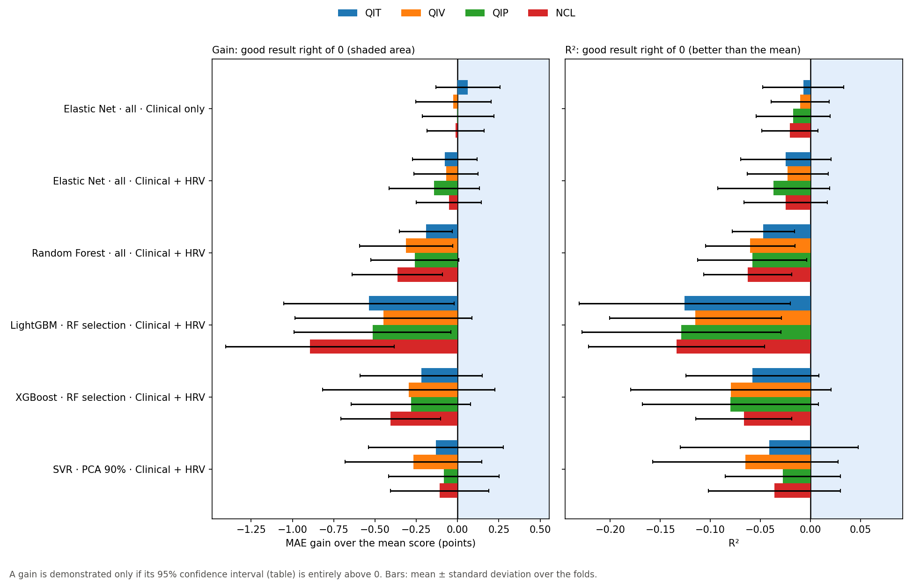
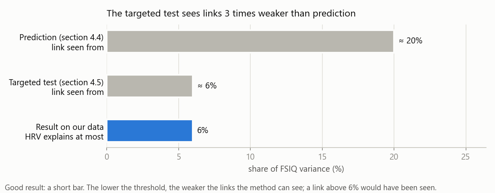
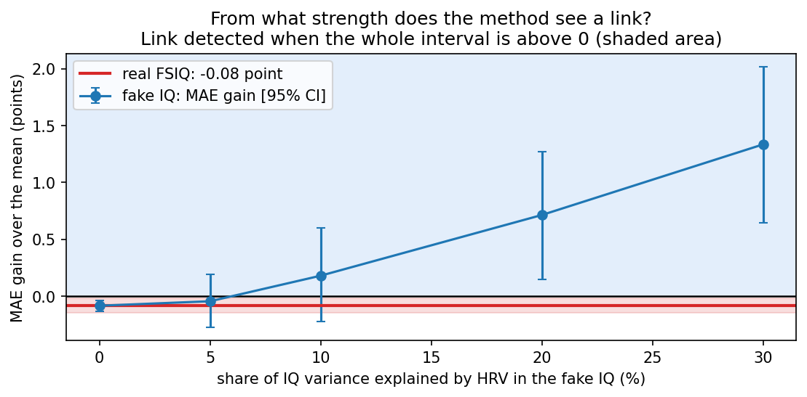
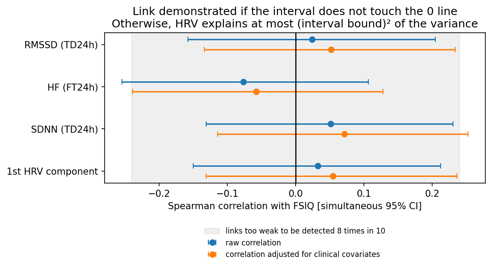
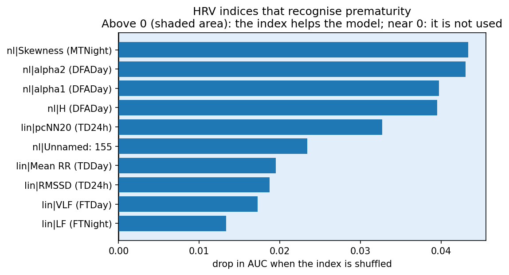
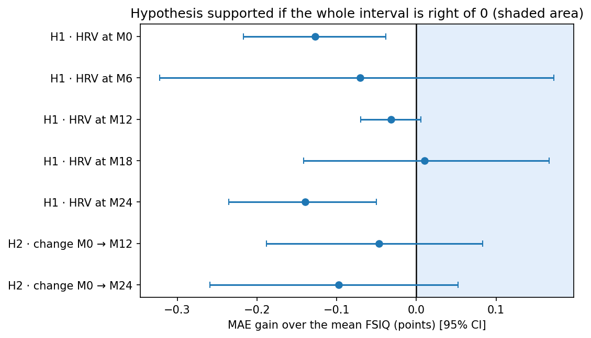

# Predicting IQ at age 3 from neonatal HRV

*Group A · Jade · PRI 2026 · AuBE cohort (Saint-Étienne University Hospital) · as of 5 November 2026* · *Version française : [README_fr.md](README_fr.md)*

**Question**: do heart rate variability (HRV) indices recorded at birth help predict the IQ measured around age 3 (WPPSI-III), beyond clinical factors?

**Short answer**: no, with these data. No model does better than predicting the mean IQ, and the HRV indices tested explain **at most 6%** of the IQ variance. Yet the method is not blind: with the same data, it does recognise premature children (AUC 0.79).

Contents: [1. Files](#1-files-in-this-folder) · [2. Running](#2-running-the-notebook) · [3. Reusing](#3-reusing-the-code) · [4. How it works](#4-how-it-works) · [5. Attempts and errors](#5-attempts-and-errors) · [6. Results](#6-results) · [7. Pitfalls](#7-pitfalls-to-avoid) · [8. Limitations](#8-limitations-and-next-steps)

> The diagrams render on GitHub. In VS Code, install the "Markdown Preview Mermaid Support" extension.

---

## 1. Files in this folder

| File                            | Role                                                                                                                                                                      |
| ------------------------------- | ------------------------------------------------------------------------------------------------------------------------------------------------------------------------- |
| `01_prediction_qit_en.ipynb`  | **the notebook to open**: every step and every result, in English                                                                                                   |
| `01_prediction_qit.ipynb`     | the same notebook in French (same computations, same numbers)                                                                                                             |
| `outils_qit.py`               | the technical code (reading, cleaning, models, plots), organised by notebook section. Function names are French, each with an English alias listed at the end of the file |
| `donnees_synthetiques.py`     | creates **fake** data in the exact format of the real files, to try the notebook                                                                                    |
| `verifier_bornes.py`          | checks the section 4.5 test on 8,000 simulated datasets (1 minute)                                                                                                        |
| `corriger_hrv_nonlineaire.py` | fixes the 9 shifted rows of `HRV_NonLineaire_Full.csv` (already done, run once only)                                                                                    |
| `results/en/`                 | **aggregated** results of the English notebook: `SUMMARY.md`, `model_comparison.csv`, plots (`results/` holds the French ones)                                |
| `docs/`                       | the explanatory figures of this document                                                                                                                                  |

The data (`data/`) are never in git: they are children's health data, and the repository is public.

Target names keep the French codes of the data files: **QIT** = Full Scale IQ (FSIQ), **QIV** = Verbal IQ, **QIP** = Performance IQ, **NCL** = General Language Composite.

---

## 2. Running the notebook

**Installation** (once per computer, Python 3.14):

```powershell
cd FSIQ-from-ECG
py -3.14 -m venv .venv                     # Mac/Linux: python3.14 -m venv .venv
.venv\Scripts\Activate.ps1                 # Mac/Linux: source .venv/bin/activate
python -m pip install -r requirements.txt
nbstripout --install                       # clears notebook outputs at each commit: MANDATORY
```

`nbstripout --install` is not stored in the repository: run it again on **every new clone**. Without it, a commit would push the notebook outputs, including child-by-child plots, to the public repository.

**Data**: put `HRV_Lineaire_Full.csv`, `HRV_NonLineaire_Full.csv` and `Résultats WPPSI III.csv` in `data/`.

**Run**: open `01_prediction_qit_en.ipynb`, pick the `.venv` kernel, then *Run All*.

| Setting           | Duration         | Purpose                                       |
| ----------------- | ---------------- | --------------------------------------------- |
| `QUICK = True`  | a few minutes    | check that everything runs (1 repeat)         |
| `QUICK = False` | about 25 minutes | the results to report (10 repeats × 5 folds) |

---

## 3. Reusing the code

### Trying it without the real data

In the notebook settings: `SYNTHETIC_DATA = True`. The notebook creates fake data in `data/synthetique/` (same columns, same format quirks as the real files, random values) and everything runs end to end. Results go to `data/synthetique/results/`: they do not overwrite the real ones, and the summary is marked "SYNTHETIC DATA". Two links are planted on purpose in these fake data (HRV → prematurity, strong; HRV → IQ, weak) so that the analyses have something to find.

### Testing your own model

Any scikit-learn model goes through exactly the same protocol as the others: same children, same folds, variable preparation redone within each fold, evaluation by `evaluate_model.py`. In section 3 of the notebook:

```python
from sklearn.linear_model import Ridge
CUSTOM_MODELS = {"Ridge": Ridge(alpha=10)}
EXPERIMENTS = [
    ("Elastic Net", "all", "Clinical only"),          # the clinical baseline, keep it
    ("Ridge", "all", "Clinical + HRV"),               # the new model
    # selections: "all", "RF selection", "PCA 90%"
    # feature sets: "Clinical only", "HRV only", "Clinical + HRV"
]
```

The model is copied fresh into each fold. To tune its hyperparameters without leakage, pass an object that tunes itself (`RidgeCV`, `GridSearchCV(...)`, `RandomizedSearchCV(...)`).

### Adapting it to other data

The settings to change are marked `[TO ADAPT]` in the notebook and `[À ADAPTER]` at the top of `outils_qit.py`.

| I want…                               | Where                    | What to change                                                                                                                |
| -------------------------------------- | ------------------------ | ----------------------------------------------------------------------------------------------------------------------------- |
| other files                            | notebook settings        | `FILES`                                                                                                                     |
| other column names                     | top of `outils_qit.py` | `COL_ID_HRV`, `COL_ID_WPPSI`, `COL_PASSAGE`, `COLS_SCORES`, `COLS_CLINIQUES`, `MOTIFS_EXCLUS` (excluded patterns) |
| to predict other scores                | notebook settings        | `TARGETS` (among `COLS_SCORES`); sections 4.3 to 10 detail FSIQ                                                           |
| other cleaning or selection thresholds | top of `outils_qit.py` | `SEUIL_CORR` (correlation), `TOP_K`, `VARIANCE_PCA`, `MAX_MANQUANTS_COL` (missing values)…                           |
| other hyperparameters                  | `outils_qit.py`        | `ESPACES` (also reachable as `tools.SEARCH_SPACES`)                                                                       |
| more or fewer repeats                  | notebook settings        | `T_REPEATS`, `K_FOLDS`, `N_ITER`                                                                                        |
| other indices for the bound (4.5)      | notebook settings        | `A_PRIORI_INDICES`, to be fixed **before** seeing the results                                                         |

### Using the tools in your own notebook

After a first run of the notebook, which creates `cohort.csv` and `folds.csv` in `data/cleaned/`:

```python
import sys
from pathlib import Path
ROOT = Path("../..").resolve()                       # the folder that contains evaluate_model.py
sys.path[:0] = [str(ROOT), str(ROOT / "GroupA" / "Jade")]
import outils_qit as tools
from evaluate_model import load_labels
from sklearn.linear_model import Ridge

tools.set_language("en")                             # English messages and tables
sources = tools.load_files(ROOT / "data", {"lin": "HRV_Lineaire_Full.csv", "nl": "HRV_NonLineaire_Full.csv",
                                           "wppsi": "Résultats WPPSI III.csv"})
data = tools.build_dataset(sources, "M0")                     # one recording per child, at birth
folds = tools.shared_folds(ROOT / "data" / "cleaned" / "folds.csv", range(1, 11))
y = load_labels(ROOT / "data" / "cleaned" / "cohort.csv", ["QIT"]).loc[data.index, "QIT"]
X = data.filter(regex=r"^(lin|nl|clin)\|")                    # HRV indices and clinical covariates
P = tools.cross_predictions(X, y, folds, Ridge(alpha=10))     # out-of-fold predictions
print(tools.gain_vs_mean(y, P, folds))                        # gain over the mean and its 95% CI
```

Every function has an explanation (`help(tools.cross_predictions)`, written in French) and an English name (list at the end of `outils_qit.py`).

### Three rules to keep

1. **Everything that learns happens within the folds**, on the training children only: imputation, selection, tuning, model. This is what `tools.build_pipeline` does; do not prepare the variables on all children before cross-validation.
2. **Never put the WPPSI scores (or their subtests) among the inputs**: they contain the answer (see [Pitfalls](#7-pitfalls-to-avoid)).
3. **Never save or share the individual-level plots** (sections 4.3 and 8). Only aggregated plots are saved to `results/`.

---

## 4. How it works

```mermaid
flowchart LR
    A["3 CSV files<br/>linear HRV, non-linear HRV, WPPSI"] --> B["Cleaning<br/>never looks at IQ"]
    B --> C["Shared folds<br/>10 repeats × 5 folds<br/>folds.csv"]
    C --> S
    subgraph S ["Within each fold, on the training children only"]
        direction LR
        D["Gaps filled<br/>with the median"] --> E["One variable per group<br/>correlated above 0.95"] --> F["Normal distribution"] --> G["Selection<br/>all, forest, PCA"] --> H["Model tuned<br/>by inner 5-fold CV"]
    end
    S --> I["Prediction of the<br/>test-fold children"]
    I --> J["evaluate_model.py<br/>MAE, R², gain over the mean, 95% CI"]
```



Each child is therefore predicted by a model that has never seen it: not to learn, not to choose its variables, not to tune its hyperparameters. The **baseline** to beat predicts, in each fold, the mean IQ of the training children. A model adds something only if the confidence interval of its **gain** over this baseline is above 0.

The code was developed and tested on synthetic data (`donnees_synthetiques.py`): the real data never leave `data/`.

---

## 5. Attempts and errors



| #  | Attempt                                                                                 | What went wrong                                                                                                                          | What was done                                                                                                                                                                                          |
| -- | --------------------------------------------------------------------------------------- | ---------------------------------------------------------------------------------------------------------------------------------------- | ------------------------------------------------------------------------------------------------------------------------------------------------------------------------------------------------------ |
| 1  | Elastic Net-only notebook on the HRV indices                                            | a single method, no shared protocol                                                                                                      | starting point, replaced by the full version                                                                                                                                                           |
| 2  | Reading the 3 files                                                                     | ID column not found: Windows encoding, WPPSI header on 2 rows, unreadable accent "Num�ro"                                               | column names compared without accents or case, "�" accepted as a wildcard                                                                                                                             |
|    |                                                                                         | a **units row** (M/F, ms…) under the HRV header, read as a child                                                                  | row detected and skipped                                                                                                                                                                               |
|    |                                                                                         | `TypeError`: "-" cells in numeric columns                                                                                              | "", " ", "-", "NaN"… become missing values                                                                                                                                                            |
|    |                                                                                         | the birth visit written "MO" (letter O) instead of "M0"                                                                                  | visit names harmonised                                                                                                                                                                                 |
|    |                                                                                         | children in the WPPSI file but missing from the HRV files                                                                                | removed; files are linked by subject number, the birth date is used as a check (initials repeat)                                                                                                       |
| 3  | Restructuring along the week plan: preparation, selection, 5 models, 10 × 5 evaluation |                                                                                                                                          | the team's `evaluate_model.py`, LightGBM and XGBoost, conformal prediction, explanation                                                                                                              |
| 4  | First run                                                                               | over 10 minutes in quick mode; a tuning search redid the whole preparation for each candidate                                            | Elastic Net computes its whole penalty path at once; random search over 12 combinations instead of a full grid. The full mode takes about 25 minutes                                                   |
| 5  | Checking the files                                                                      | **9 rows** of `HRV_NonLineaire_Full.csv` shifted by 2 columns from column CB onwards; the "empty" end-of-row cells contained "-" | `corriger_hrv_nonlineaire.py`: backs up the original, previews before writing, refuses to run twice                                                                                                  |
| 6  | Full results (10 × 5)                                                                  | **no model beats the mean**; tree models even do worse                                                                             | see 7 to 10: understand before trying something else                                                                                                                                                   |
| 7  | Why?                                                                                    | the strongest correlation with FSIQ (0.16) is no stronger than with a random IQ (0.17)                                                   | a **simulation** shows the method only sees a link from 20% of explained variance                                                                                                                |
| 8  | Positive control: does HRV recognise prematurity?                                       |                                                                                                                                          | **yes, AUC 0.79**: data and method can see a link when there is one                                                                                                                              |
| 9  | Other leads: FSIQ < 90, HRV at 6, 12, 18 and 24 months, change in HRV                   | none works (AUC 0.50; 7 hypotheses not supported)                                                                                        |                                                                                                                                                                                                        |
| 10 | Targeted test on 4 indices chosen in advance (RMSSD, HF, SDNN, overall summary)         | a 1st version (bootstrap) reported too many false links: 6.3% over 300 simulated datasets, instead of 5% at most                         | replaced by the Fisher interval, checked on 8,000 simulated datasets (figure below); **at most 6% of variance**                                                                                  |
| 11 | Notebook too heavy to read                                                              | 921 lines of code in the notebook                                                                                                        | technical code moved to `outils_qit.py` (about 300 lines remain in the notebook, a dozen per cell); two less rigorous simplifications were undone; numbers checked identical to the previous version |
| 12 | English version and requirements checking                                               | the library versions in `requirements.txt` are newer                                                                                   | everything identical except **LightGBM**, which is sensitive to versions (never the best model: summary unchanged); `nbstripout` to reinstall on each clone                                    |



---

## 6. Results

*Full run of 4 November 2026: 189 children, 25 linear and 45 non-linear HRV indices (recording at birth), 6 clinical covariates, 10 × 5 folds. Details in [`results/en/SUMMARY.md`](results/en/SUMMARY.md). The plots in `results/en/` are produced by the English notebook: run it with `QUICK = False` to update them.*

**Reading the plots**: the **shaded area** marks the side of a good result (a gain, an improvement). A result is demonstrated only if its **whole** interval lies there, not just the middle point.

### No model beats the mean

| Target            | Best model                 | MAE   | MAE of the mean | Gain [95% CI]         |
| ----------------- | -------------------------- | ----- | --------------- | --------------------- |
| QIT (full scale)  | Elastic Net, clinical only | 10.33 | 10.39           | +0.06 [−0.12, 0.23]  |
| QIV (verbal)      | Elastic Net, clinical only | 11.68 | 11.66           | −0.02 [−0.22, 0.16] |
| QIP (performance) | Elastic Net, clinical only | 9.75  | 9.75            | +0.00 [−0.16, 0.17]  |
| NCL (language)    | Elastic Net, clinical only | 11.64 | 11.62           | −0.01 [−0.15, 0.13] |

Adding HRV to the clinical model does slightly **worse** (FSIQ MAE from 10.33 to 10.47). The 90% prediction interval for a child is ± 21.3 points, versus ± 20.9 around the plain mean FSIQ.



### What the method could see, and what we can state

Prediction only detects a link from about 20% of explained variance (simulation, section 4.4 of the notebook). The targeted test of section 4.5 is more sensitive: it sees a link from 6%. It finds none, and bounds the share of FSIQ explained by these HRV indices to **6% at most**, both before and after accounting for the clinical covariates.



| Simulation (4.4)                         | Bound (4.5)                      |
| ---------------------------------------- | -------------------------------- |
|  |  |

### Positive control, other leads

- **Prematurity** (positive control): HRV alone recognises it, AUC 0.79 [0.67, 0.93]. The plot shows the indices that contribute most.
- **FSIQ < 90** (40 children): AUC 0.50 [0.39, 0.61], like chance.
- **Later HRV (M6 to M24) and change in HRV**: 7 hypotheses, none supported.

| Prematurity (9)                                        | Hypotheses (7)                           |
| ------------------------------------------------------ | ---------------------------------------- |
|  |  |

---

## 7. Pitfalls to avoid

- **Target leakage**: putting the WPPSI subtests, QIV or QIP among the variables to predict FSIQ gives an R² close to 1, because FSIQ is computed from them. A result that looks too good should prompt a search for leakage.
- **Choosing the variables on all children** before cross-validation: the test children "help" prepare the model, so the score is too optimistic.
- **Reporting the tuning score** (`best_score_` of a hyperparameter search) as the performance: it is optimistic by construction. Use nested cross-validation.
- **Accuracy with imbalanced classes**: with 79% of children above 90, always answering "≥ 90" gives 79% accuracy while knowing nothing. Look at the AUC, sensitivity, balanced accuracy and kappa instead.
- **Multiple comparisons**: out of 7 hypotheses, an isolated success may be due to chance.
- **Choosing the "a priori" indices of section 4.5 after the fact**: the test would lose its validity.
- **Identifiers**: initials and birth date are not enough (they repeat); link by subject number.
- **Empty cells** are written four ways in these files: nothing, a space, "-" or "NaN".
- **nbstripout** is not stored in the repository: run `nbstripout --install` on each clone, before the first commit.
- **Library versions**: install `requirements.txt` everywhere; LightGBM predictions can change from one version to another.

---

## 8. Limitations and next steps

- About 190 children, a single cohort, no external validation.
- IQ at age 3 depends on many things absent here (family environment, socio-economic status, events of the first years).
- Association is not causation: a predictive model does not say how to improve a child's IQ.
- **Next steps**: variables derived from the raw data (RR files, ECG signal) are Group B's work; any supported lead should be confirmed on another cohort.
