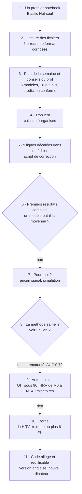
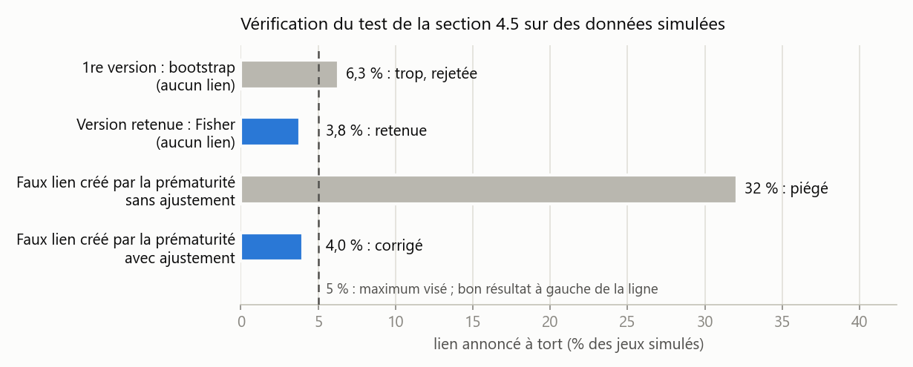
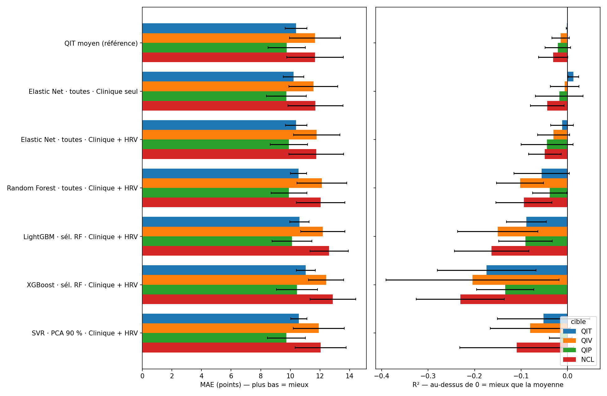
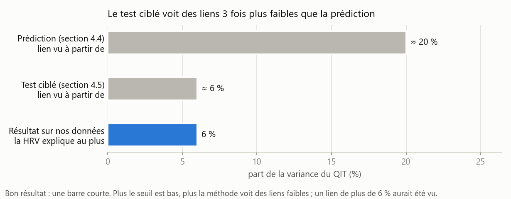
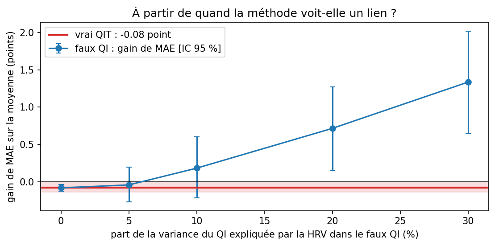
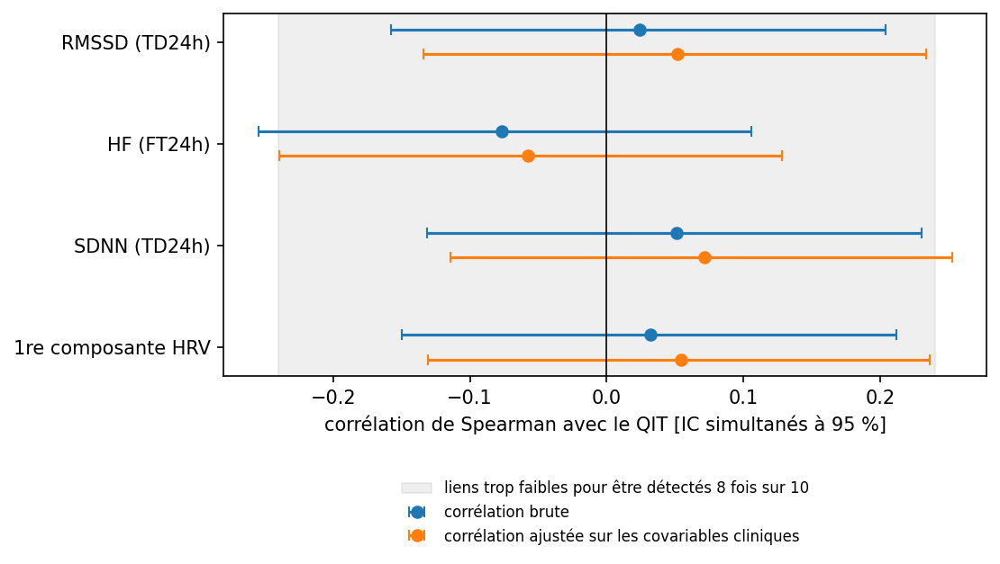
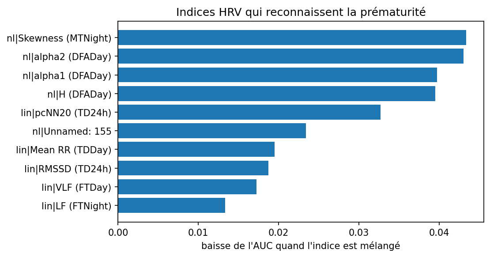
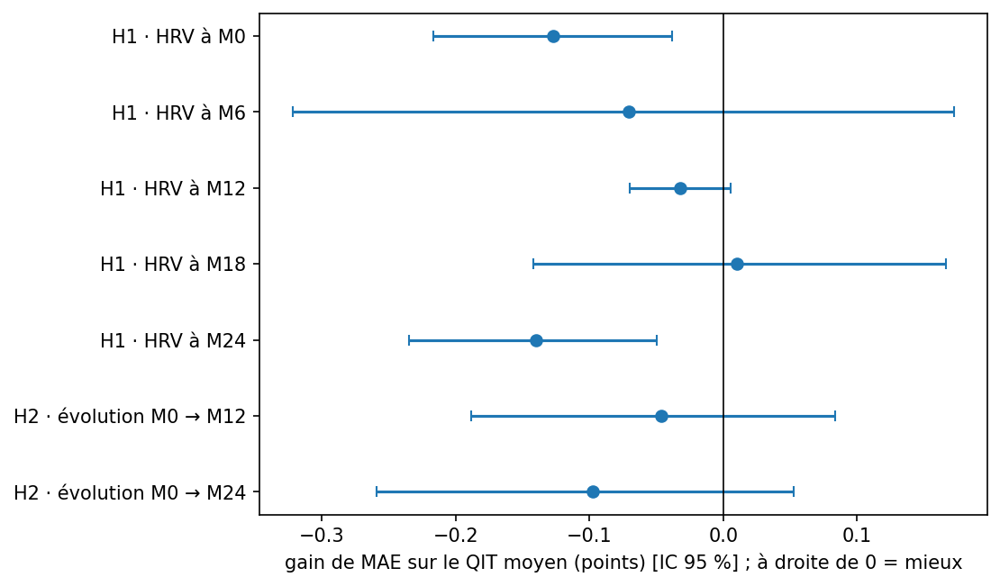

# Prédire le QI à 3 ans à partir de la HRV néonatale

*Groupe A · Jade · PRI 2026 · cohorte AuBE (CHU Saint-Étienne) · état au 5 novembre 2026* · *English version: [README.md](README.md)*

**Question** : les indices de variabilité cardiaque (HRV) enregistrés à la naissance aident-ils à prédire le QI mesuré vers 3 ans (WPPSI-III), au-delà des facteurs cliniques ?

**Réponse courte** : non, avec ces données. Aucun modèle ne fait mieux que prédire le QI moyen, et les indices HRV testés expliquent **au plus 6 %** de la variance du QI. La méthode n'est pourtant pas aveugle : avec les mêmes données, elle reconnaît bien les enfants prématurés (AUC 0,79).

Sommaire : [1. Fichiers](#1-les-fichiers-du-dossier) · [2. Lancer](#2-lancer-le-notebook) · [3. Réutiliser](#3-réutiliser-le-code) · [4. Comment ça marche](#4-comment-ça-marche) · [5. Essais et erreurs](#5-essais-et-erreurs) · [6. Résultats](#6-résultats) · [7. Pièges à éviter](#7-pièges-à-éviter) · [8. Limites et suite](#8-limites-et-suite)

> Les schémas s'affichent sur GitHub. Dans VS Code, il faut l'extension « Markdown Preview Mermaid Support ».

---

## 1. Les fichiers du dossier

| Fichier | Rôle |
|---|---|
| `01_prediction_qit.ipynb` | le notebook principal : toutes les étapes et tous les résultats |
| `01_prediction_qit_en.ipynb` | le même en anglais (mêmes calculs, mêmes chiffres) |
| `outils_qit.py` | le code technique (lecture, nettoyage, modèles, graphiques), rangé par section du notebook |
| `donnees_synthetiques.py` | crée de **fausses** données au format exact des vrais fichiers, pour essayer le notebook |
| `verifier_bornes.py` | vérifie le test de la section 4.5 sur 8 000 jeux simulés (1 minute) |
| `corriger_hrv_nonlineaire.py` | corrige les 9 lignes décalées de `HRV_NonLineaire_Full.csv` (déjà fait, à ne lancer qu'une fois) |
| `results/` | résultats **agrégés** : `SUMMARY.md`, `model_comparison.csv`, graphiques |
| `docs/` | les deux graphiques explicatifs de ce document |

Les données (`data/`) ne sont jamais dans git : ce sont des données de santé d'enfants, et le dépôt est public.

---

## 2. Lancer le notebook

**Installation** (une fois par ordinateur, Python 3.14) :

```powershell
cd FSIQ-from-ECG
py -3.14 -m venv .venv                     # Mac/Linux : python3.14 -m venv .venv
.venv\Scripts\Activate.ps1                 # Mac/Linux : source .venv/bin/activate
python -m pip install -r requirements.txt
nbstripout --install                       # vide les sorties des notebooks à chaque commit : OBLIGATOIRE
```

`nbstripout --install` n'est pas dans le dépôt : il faut le relancer sur **chaque nouveau clone**. Sans lui, un commit enverrait sur le dépôt public les sorties des notebooks, dont des graphiques enfant par enfant.

**Données** : mettre `HRV_Lineaire_Full.csv`, `HRV_NonLineaire_Full.csv` et `Résultats WPPSI III.csv` dans `data/`.

**Lancer** : ouvrir `01_prediction_qit.ipynb`, choisir le noyau `.venv`, puis *Run All*.

| Réglage | Durée | Pour quoi |
|---|---|---|
| `RAPIDE = True` | quelques minutes | vérifier que tout tourne (1 répétition) |
| `RAPIDE = False` | environ 25 minutes | les résultats à rapporter (10 répétitions × 5 plis) |

---

## 3. Réutiliser le code

### Essayer sans les vraies données

Dans les réglages du notebook : `DONNEES_SYNTHETIQUES = True`. Le notebook crée de fausses données dans `data/synthetique/` (mêmes colonnes, mêmes pièges de format que les vrais fichiers, valeurs tirées au hasard) et tout tourne de bout en bout. Les résultats vont dans `data/synthetique/results/` : ils n'écrasent pas les vrais, et le résumé porte la mention « DONNÉES SYNTHÉTIQUES ». Deux liens sont plantés exprès dans ces fausses données (HRV → prématurité, fort ; HRV → QI, faible) pour que les analyses aient quelque chose à trouver.

### Tester son propre modèle

N'importe quel modèle scikit-learn passe par exactement le même protocole que les autres : mêmes enfants, mêmes plis, préparation des variables refaite dans chaque pli, évaluation par `evaluate_model.py`. Dans la section 3 du notebook :

```python
from sklearn.linear_model import Ridge
MODELES_PERSO = {"Ridge": Ridge(alpha=10)}
EXPERIENCES = [
    ("Elastic Net", "toutes", "Clinique seul"),       # la référence clinique, à garder
    ("Ridge", "toutes", "Clinique + HRV"),            # le nouveau modèle
    # sélections possibles : "toutes", "sél. RF", "PCA 90 %"
    # jeux de variables : "Clinique seul", "HRV seule", "Clinique + HRV"
]
```

Le modèle est copié neuf dans chaque pli. Pour régler ses hyperparamètres sans fuite, donner un objet qui se règle lui-même (`RidgeCV`, `GridSearchCV(...)`, `RandomizedSearchCV(...)`).

### Adapter à d'autres données

Les réglages à changer sont marqués `[À ADAPTER]` dans le notebook et en tête de `outils_qit.py`.

| Je veux… | Où | Quoi changer |
|---|---|---|
| d'autres fichiers | réglages du notebook | `FICHIERS` |
| d'autres noms de colonnes | en tête de `outils_qit.py` | `COL_ID_HRV`, `COL_ID_WPPSI`, `COL_PASSAGE`, `COLS_SCORES`, `COLS_CLINIQUES`, `MOTIFS_EXCLUS` |
| prédire d'autres scores | réglages du notebook | `CIBLES` (parmi `COLS_SCORES`) ; les sections 4.3 à 10 détaillent le QIT |
| d'autres seuils de nettoyage ou de sélection | en tête de `outils_qit.py` | `SEUIL_CORR`, `TOP_K`, `VARIANCE_PCA`, `MAX_MANQUANTS_COL`… |
| d'autres hyperparamètres | `outils_qit.py` | `ESPACES` |
| plus ou moins de répétitions | réglages du notebook | `T_REPETITIONS`, `K_PLIS`, `N_ITER` |
| d'autres indices pour la borne (4.5) | réglages du notebook | `INDICES_A_PRIORI`, à fixer **avant** de voir les résultats |

### Utiliser les outils dans son propre notebook

Après un premier lancement du notebook, qui crée `cohort.csv` et `folds.csv` dans `data/cleaned/` :

```python
import sys
from pathlib import Path
RACINE = Path("../..").resolve()                     # le dossier qui contient evaluate_model.py
sys.path[:0] = [str(RACINE), str(RACINE / "GroupA" / "Jade")]
import outils_qit as outils
from evaluate_model import load_labels
from sklearn.linear_model import Ridge

sources = outils.charger(RACINE / "data", {"lin": "HRV_Lineaire_Full.csv", "nl": "HRV_NonLineaire_Full.csv",
                                           "wppsi": "Résultats WPPSI III.csv"})
donnees = outils.construire_donnees(sources, "M0")            # un enregistrement par enfant à la naissance
plis = outils.plis_communs(RACINE / "data" / "cleaned" / "folds.csv", range(1, 11))
y = load_labels(RACINE / "data" / "cleaned" / "cohort.csv", ["QIT"]).loc[donnees.index, "QIT"]
X = donnees.filter(regex=r"^(lin|nl|clin)\|")                 # indices HRV et covariables cliniques
P = outils.predictions_croisees(X, y, plis, Ridge(alpha=10))  # prédictions hors pli
print(outils.gain_vs_moyenne(y, P, plis))                     # gain sur la moyenne et son IC 95 %
```

Chaque fonction a une explication (`help(outils.predictions_croisees)`) et un nom anglais (`outils.cross_predictions`, liste en fin de `outils_qit.py`).

### Trois règles à garder

1. **Tout ce qui apprend se fait dans les plis**, sur les seuls enfants d'entraînement : imputation, sélection, réglage, modèle. C'est ce que fait `faire_pipeline` ; ne pas préparer les variables sur tous les enfants avant la validation croisée.
2. **Ne jamais mettre les scores WPPSI (ni leurs sous-tests) dans les variables d'entrée** : ils contiennent la réponse (voir [Pièges](#7-pièges-à-éviter)).
3. **Ne jamais enregistrer ni partager les graphiques individuels** (sections 4.3 et 8). Seuls les graphiques agrégés sont enregistrés dans `results/`.

---

## 4. Comment ça marche

```mermaid
flowchart LR
    A["3 fichiers CSV<br/>HRV linéaire, HRV non linéaire, WPPSI"] --> B["Nettoyage<br/>ne regarde jamais le QI"]
    B --> C["Plis communs<br/>10 répétitions × 5 plis<br/>folds.csv"]
    C --> S
    subgraph S ["Dans chaque pli, sur les enfants d'entraînement seulement"]
        direction LR
        D["Trous remplis<br/>par la médiane"] --> E["Une variable par groupe<br/>corrélé à plus de 0,95"] --> F["Loi normale"] --> G["Sélection<br/>toutes, forêt, PCA"] --> H["Modèle réglé<br/>en CV interne à 5 plis"]
    end
    S --> I["Prédiction des enfants<br/>du pli de test"]
    I --> J["evaluate_model.py<br/>MAE, R², gain sur la moyenne, IC 95 %"]
```



Chaque enfant est donc prédit par un modèle qui ne l'a jamais vu, ni pour apprendre, ni pour choisir ses variables, ni pour régler ses hyperparamètres. La **référence** à battre prédit, dans chaque pli, le QI moyen des enfants d'entraînement. Un modèle n'apporte quelque chose que si l'intervalle de confiance de son **gain** sur cette référence est au-dessus de 0.

Le code a été développé et testé sur des données synthétiques (`donnees_synthetiques.py`) : les vraies données ne quittent jamais `data/`.

---

## 5. Essais et erreurs



| # | Essai | Ce qui n'allait pas | Ce qui a été fait |
|---|---|---|---|
| 1 | Notebook Elastic Net seul sur les indices HRV | une seule méthode, pas de protocole commun | point de départ, remplacé par la version complète |
| 2 | Lecture des 3 fichiers | identifiant introuvable : encodage Windows, en-tête WPPSI sur 2 lignes, accent illisible « Num�ro » | noms de colonnes comparés sans accents ni majuscules, « � » accepté comme joker |
| | | une **ligne d'unités** (M/F, ms…) sous l'en-tête HRV, lue comme un enfant | ligne détectée et ignorée |
| | | `TypeError` : des cases « - » dans des colonnes de nombres | « », « - », « NaN »… deviennent des valeurs manquantes |
| | | le passage de naissance écrit « MO » (lettre O) au lieu de « M0 » | passages harmonisés |
| | | des enfants dans le WPPSI mais absents des fichiers HRV | retirés ; les fichiers sont reliés par le numéro, la date de naissance sert de contrôle (les initiales se répètent) |
| 3 | Restructuration selon le plan de la semaine : préparation, sélection, 5 modèles, évaluation 10 × 5 | | `evaluate_model.py` de l'équipe, LightGBM et XGBoost, prédiction conforme, explication |
| 4 | Premier lancement | plus de 10 minutes en mode rapide ; une recherche de réglages refaisait toute la préparation pour chaque candidat | Elastic Net calcule tout son chemin de pénalités d'un coup ; recherche aléatoire de 12 combinaisons au lieu d'une grille complète. Le mode complet passe à environ 25 minutes |
| 5 | Contrôle des fichiers | **9 lignes** de `HRV_NonLineaire_Full.csv` décalées de 2 colonnes à partir de la colonne CB ; les cases « vides » de fin de ligne contenaient « - » | `corriger_hrv_nonlineaire.py` : sauvegarde de l'original, aperçu avant d'écrire, refuse de tourner deux fois |
| 6 | Résultats complets (10 × 5) | **aucun modèle ne bat la moyenne** ; les arbres font même moins bien | voir 7 à 10 : comprendre avant de chercher autre chose |
| 7 | Pourquoi ? | la plus forte corrélation avec le QIT (0,16) n'est pas plus forte qu'avec un QI tiré au hasard (0,17) | une **simulation** montre que la méthode ne voit un lien qu'à partir de 20 % de variance expliquée |
| 8 | Contrôle positif : la HRV reconnaît-elle la prématurité ? | | **oui, AUC 0,79** : données et méthode savent voir un lien quand il existe |
| 9 | Autres pistes : QIT < 90, HRV à 6, 12, 18 et 24 mois, évolution de la HRV | aucune ne marche (AUC 0,50 ; 7 hypothèses non soutenues) | |
| 10 | Test ciblé sur 4 indices choisis à l'avance (RMSSD, HF, SDNN, résumé global) | une 1re version (bootstrap) annonçait trop de faux liens : 6,3 % sur 300 jeux simulés, au lieu de 5 % au plus | remplacée par l'intervalle de Fisher, vérifiée sur 8 000 jeux simulés (figure ci-dessous) ; **au plus 6 % de variance** |
| 11 | Notebook jugé trop lourd à lire | 921 lignes de code dans le notebook | code technique déplacé dans `outils_qit.py` (environ 300 lignes restent dans le notebook, une douzaine par cellule) ; deux simplifications moins rigoureuses ont été annulées ; chiffres vérifiés identiques à l'ancienne version |
| 12 | Version anglaise, puis un nouvel ordinateur | les versions des bibliothèques de `requirements.txt` sont plus récentes que celles de l'ordinateur d'origine | tout est identique sauf **LightGBM**, sensible aux versions (jamais le meilleur modèle : résumé inchangé) ; `nbstripout` à réinstaller sur chaque clone |



---

## 6. Résultats

*Lancement complet du 4 novembre 2026 : 189 enfants, 25 indices HRV linéaires et 45 non linéaires (enregistrement à la naissance), 6 covariables cliniques, 10 × 5 plis. Le détail est dans [`results/SUMMARY.md`](results/SUMMARY.md). Les graphiques de `results/` sont produits par le notebook : relancer `RAPIDE = False` pour les mettre à jour.*

**Lire les graphiques** : la **zone bleutée** marque le côté d'un bon résultat (un gain, une amélioration). Un résultat n'est démontré que si **tout** son intervalle y est, pas seulement le point du milieu.

### Aucun modèle ne bat la moyenne

| Cible | Meilleur modèle | MAE | MAE de la moyenne | Gain [IC 95 %] |
|---|---|---|---|---|
| QIT (total) | Elastic Net, clinique seul | 10,33 | 10,39 | +0,06 [−0,12 ; 0,23] |
| QIV (verbal) | Elastic Net, clinique seul | 11,68 | 11,66 | −0,02 [−0,22 ; 0,16] |
| QIP (performance) | Elastic Net, clinique seul | 9,75 | 9,75 | +0,00 [−0,16 ; 0,17] |
| NCL (langage) | Elastic Net, clinique seul | 11,64 | 11,62 | −0,01 [−0,15 ; 0,13] |

Ajouter la HRV au modèle clinique fait légèrement **moins bien** (MAE du QIT de 10,33 à 10,47). L'intervalle de prédiction à 90 % pour un enfant fait ± 21,3 points, contre ± 20,9 autour du simple QIT moyen.



### Ce que la méthode pouvait voir, et ce qu'on peut affirmer

La prédiction ne détecte un lien qu'à partir d'environ 20 % de variance expliquée (simulation, section 4.4 du notebook). Le test ciblé de la section 4.5 est plus sensible : il voit un lien dès 6 %. Il n'en trouve aucun, et borne la part du QIT expliquée par ces indices HRV à **6 % au plus**, avant comme après prise en compte des covariables cliniques.



| Simulation (4.4) | Borne (4.5) |
|---|---|
|  |  |

### Contrôle positif, autres pistes

- **Prématurité** (contrôle positif) : la HRV seule la reconnaît, AUC 0,79 [0,67 ; 0,93]. Le graphique montre les indices qui y contribuent le plus.
- **QIT < 90** (40 enfants) : AUC 0,50 [0,39 ; 0,61], comme le hasard.
- **HRV plus tardive (M6 à M24) et évolution de la HRV** : 7 hypothèses, aucune soutenue.

| Prématurité (9) | Hypothèses (7) |
|---|---|
|  |  |

---

## 7. Pièges à éviter

- **Fuite de la cible** : mettre les sous-tests WPPSI, le QIV ou le QIP parmi les variables pour prédire le QIT donne un R² proche de 1, parce que le QIT est calculé à partir d'eux. Un résultat trop beau doit faire chercher une fuite.
- **Choisir les variables sur tous les enfants** avant la validation croisée : les enfants de test « aident » à préparer le modèle, le score est trop optimiste.
- **Rapporter le score de réglage** (`best_score_` d'une recherche d'hyperparamètres) comme performance : il est optimiste par construction. Il faut une validation croisée imbriquée.
- **L'exactitude avec des classes déséquilibrées** : avec 79 % d'enfants au-dessus de 90, répondre toujours « ≥ 90 » donne 79 % d'exactitude sans rien savoir. Regarder l'AUC, la sensibilité, l'exactitude équilibrée, le kappa.
- **Les comparaisons multiples** : sur 7 hypothèses, une réussite isolée peut venir du hasard.
- **Choisir après coup** les indices « à priori » de la section 4.5 : le test perdrait sa validité.
- **Les identifiants** : les initiales et la date de naissance ne suffisent pas (elles se répètent) ; relier par le numéro.
- **Les cases vides** s'écrivent de quatre façons dans ces fichiers : rien, une espace, « - » ou « NaN ».
- **nbstripout** n'est pas dans le dépôt : `nbstripout --install` sur chaque clone, avant le premier commit.
- **Les versions des bibliothèques** : installer `requirements.txt` partout ; LightGBM peut changer de prédictions d'une version à l'autre.

---

## 8. Limites et suite

- Environ 190 enfants, une seule cohorte, pas de validation externe.
- Le QI à 3 ans dépend de beaucoup de choses absentes ici (environnement familial, niveau socio-économique, événements des premières années).
- Une association n'est pas une cause : un modèle prédictif ne dit pas comment améliorer le QI d'un enfant.
- **Suite** : les variables tirées des données brutes (fichiers RR, signal ECG) sont le travail du groupe B ; toute piste soutenue devrait être confirmée sur une autre cohorte.
