# Prédire le QI à 3 ans à partir de la HRV néonatale

*Groupe A · Jade · PRI 2026 · cohorte AuBE (CHU Saint-Étienne)* · *English version: [README.md](README.md)*

**Question** : les indices de variabilité cardiaque (HRV) enregistrés à la naissance aident-ils à prédire le QI mesuré vers 3 ans (WPPSI-III), au-delà des facteurs cliniques ?

**Réponse courte** : non, avec ces données. Aucun modèle ne fait mieux que prédire le QI moyen, et les indices HRV testés expliquent **au plus 6 %** de la variance du QI. La méthode n'est pourtant pas aveugle : avec les mêmes données, elle reconnaît les enfants prématurés (AUC 0,79 : lien démontré, discrimination acceptable).

**État du travail** : toutes les analyses ont tourné sur les vraies données, y compris les méthodes ajoutées après les retours des enseignants (étape 11). Les résultats agrégés sont dans [`results/`](results/) ; le résumé chiffré, avec sa date de génération, est [`results/SUMMARY.md`](results/SUMMARY.md).

Sommaire : [1. Fichiers](#1-les-fichiers-du-dossier) · [2. Lancer](#2-lancer-le-notebook) · [3. Lire les résultats](#3-lire-les-résultats--à-partir-de-quand-cest-bon) · [4. Comment ça marche](#4-comment-ça-marche) · [5. Ce qui a été fait, étape par étape](#5-ce-qui-a-été-fait-étape-par-étape) · [6. Réutiliser](#6-réutiliser-le-code) · [7. Pièges](#7-pièges-à-éviter) · [8. Reprendre le travail](#8-reprendre-le-travail) · [9. Limites](#9-limites)

> Les schémas s'affichent sur GitHub. Dans VS Code, il faut l'extension « Markdown Preview Mermaid Support ».

---

## 1. Les fichiers du dossier

| Fichier                         | Rôle                                                                                                                                                            |
| ------------------------------- | ---------------------------------------------------------------------------------------------------------------------------------------------------------------- |
| `01_prediction_qit.ipynb`     | le notebook principal : toutes les étapes et tous les résultats                                                                                                |
| `01_prediction_qit_en.ipynb`  | le même en anglais (mêmes calculs, mêmes chiffres)                                                                                                            |
| `outils_qit.py`               | le code technique (lecture, nettoyage, modèles, graphiques), rangé par section du notebook                                                                     |
| `donnees_synthetiques.py`     | crée de **fausses** données au format exact des vrais fichiers, pour essayer le notebook                                                                 |
| `verifier_bornes.py`          | vérifie le test de la section 4.5 sur 8 000 jeux simulés (1 minute)                                                                                            |
| `corriger_hrv_nonlineaire.py` | corrige les 9 lignes décalées de `HRV_NonLineaire_Full.csv` (déjà fait, à ne lancer qu'une fois)                                                          |
| `results/`                    | résultats **agrégés** : `SUMMARY.md` (avec le tableau de tous les modèles), `reglages_retenus_QIT.md`, graphiques (`results/en/` : ceux du notebook anglais). `model_comparison.csv` y est aussi écrit, mais reste local, comme tous les `.csv` du dépôt |
| `docs/`                       | les graphiques explicatifs de ce document                                                                                                                        |

Les données (`data/`) ne sont jamais dans git : ce sont des données de santé d'enfants, et le dépôt est public.

**Et `GroupA/clean_data.py` ?** C'est le script de nettoyage de l'équipe (anciennement `data/pulisci_righe.py`). Il écrit des copies nettoyées dans un dossier `puliti/` et ne garde que les enregistrements de naissance (M0). Le notebook ne s'en sert pas, parce qu'il a aussi besoin des enregistrements de 6 à 24 mois (section 7, hypothèses) : il lit les fichiers d'origine et applique les mêmes principes (fichiers reliés par le numéro du sujet, date de naissance comme contrôle, enfants sans tous leurs scores retirés). Comme il lit les fichiers d'origine, les 9 lignes décalées y sont corrigées directement, par `corriger_hrv_nonlineaire.py` (étape 4).

Les cibles : **QIT** = QI total, **QIV** = QI verbal, **QIP** = QI de performance, **NCL** = note composite de langage.

---

## 2. Lancer le notebook

**Installation** (une fois par ordinateur, Python 3.14) :

```powershell
cd FSIQ-from-ECG
py -3.14 -m venv .venv                     # Mac/Linux : python3.14 -m venv .venv
.venv\Scripts\Activate.ps1                 # Mac/Linux : source .venv/bin/activate
python -m pip install -r requirements.txt
nbstripout --install                       # vide les sorties des notebooks à chaque commit : OBLIGATOIRE
```

`nbstripout --install` n'est pas dans le dépôt : il faut le relancer sur **chaque nouveau clone**. Sans lui, un commit enverrait sur le dépôt public les sorties des notebooks, dont des graphiques enfant par enfant.

**Données** : mettre `HRV_Lineaire_Full.csv`, `HRV_NonLineaire_Full.csv` et `Résultats WPPSI III.csv` dans `data/`. Pas de données ? `DONNEES_SYNTHETIQUES = True` (section 6).

**Lancer** : ouvrir `01_prediction_qit.ipynb`, choisir le noyau `.venv`, puis *Run All*.

| Réglage           | Durée             | Pour quoi                                                |
| ------------------ | ------------------ | -------------------------------------------------------- |
| `RAPIDE = True`  | environ 5 minutes  | vérifier que tout tourne (1 répétition)               |
| `RAPIDE = False` | environ 40 minutes | les résultats à rapporter (10 répétitions × 5 plis) |

---

## 3. Lire les résultats : à partir de quand c'est bon

Chaque chiffre du notebook est accompagné de sa lecture. Le tableau les rassemble.

| Mesure (section)                            | Ce que c'est                                                                                     | Bonne valeur                                                                                                                 |
| ------------------------------------------- | ------------------------------------------------------------------------------------------------ | ---------------------------------------------------------------------------------------------------------------------------- |
| **MAE** (4)                           | erreur moyenne, en points de QI                                                                  | plus petite que la MAE de la **référence** (le QI moyen) : 10,39 pour le QIT                                         |
| **Gain sur la moyenne** [IC 95 %] (4) | MAE de la référence − MAE du modèle                                                          | **démontré seulement si tout l'IC est au-dessus de 0** ; un gain positif dont l'IC contient 0 n'est pas un résultat ; tout l'IC sous 0 : moins bien que la moyenne |
| **R²** (4)                           | part de la variance du QI expliquée, hors pli                                                   | > 0 : mieux que la moyenne ; 0 : pareil ; < 0 : moins bien ; 1 : parfait                                                     |
| Plus forte corrélation contre hasard (1.4) | plus forte corrélation de Spearman avec le QIT, comparée à des QI mélangés                  | un lien n'existe qu'au-dessus du niveau du hasard (95e centile)                                                              |
| Simulation (4.4)                            | gain sur un faux QI dont le lien avec la HRV est connu                                           | lien détecté quand tout l'IC est au-dessus de 0                                                                            |
| **ρ de Spearman, borne** (4.5)       | corrélation d'un indice choisi avec le QIT, IC simultané à 95 %                               | lien démontré si l'IC exclut 0 ; sinon (borne de l'IC)² = la plus grande part de variance compatible avec les données    |
| **AUC** (5, 6)                        | probabilité que le modèle classe un enfant « positif » au-dessus d'un « négatif »         | 0,5 = hasard ; **démontrée si l'IC bas > 0,5** ; 0,7–0,8 acceptable, 0,8–0,9 excellente, ≥ 0,9 exceptionnelle     |
| Exactitude équilibrée (6)                 | moyenne de la sensibilité et de la spécificité                                                | 0,5 = hasard                                                                                                                 |
| **Kappa de Cohen** (6)                | accord au-delà du hasard                                                                        | 0 = hasard ; 0,2–0,4 faible ; 0,4–0,6 modéré ; > 0,6 fort                                                                |
| Hypothèse (7)                              | gain sur la moyenne avec la HRV plus tardive ou son évolution                                   | soutenue si tout l'IC est au-dessus de 0 ; tout l'IC sous 0 : moins bien que la moyenne ; avec 7 tests, une hypothèse soutenue serait à confirmer ailleurs |
| **Intervalle conforme** (8)           | ± q points qui contiennent le vrai QIT environ 9 fois sur 10                                    | couverture ≈ 90 % **et** plus étroit que l'intervalle autour de la moyenne                                           |
| Importance par permutation (9)              | baisse de l'AUC quand on mélange une variable                                                   | > 0 : la variable aide                                                                                                       |
| **Importance d'impureté, SHAP** (9)  | à quel point l'arbre s'appuie sur une variable                                                  | au-dessus du **seuil du hasard** (même classement avec le QI mélangé) : zone bleutée des graphiques                |
| **Accord des top 5** (9)              | à quel point les 5 premières variables se retrouvent d'un pli à l'autre                       | au-dessus du seuil du hasard : classement stable ; sinon, ne pas l'interpréter                                              |
| **Effet SHAP par quintile** (9)       | changement de la prédiction entre les valeurs les plus basses et les plus hautes d'une variable | l'effet compte s'il sort de la zone grise (hasard)                                                                           |
| Poids du multi-noyaux (4.2)                 | poids donné à la clinique, à la HRV linéaire, à la HRV non linéaire                        | un poids HRV de 0 veut dire que la HRV n'aide pas                                                                            |

**Petit glossaire**

- **HRV** : variabilité de la fréquence cardiaque, calculée à partir de l'ECG ; indices comme RMSSD, SDNN, puissance HF.
- **M0, M6, … M24** : âge en mois à l'enregistrement ; M0 = la naissance, l'analyse principale.
- **Pli, 10 × 5** : les enfants sont répartis en 5 groupes ; chaque groupe sert à son tour de groupe de test pendant que le modèle apprend sur les 4 autres. On recommence 10 fois avec des répartitions différentes.
- **Enfants d'entraînement / de test** : le modèle apprend seulement sur les enfants d'entraînement ; il est jugé seulement sur les enfants de test, qu'il n'a jamais vus.
- **Référence (score moyen)** : « prédire pour tout le monde le QI moyen des enfants d'entraînement ». Un modèle utile doit la battre.
- **Validation croisée interne** : un second découpage, à l'intérieur des seuls enfants d'entraînement, pour choisir les réglages d'un modèle sans jamais toucher aux enfants de test.
- **Fuite** : quand une information sur les enfants de test ou sur la réponse arrive jusqu'au modèle ; les résultats paraissent alors bien meilleurs qu'ils ne sont.
- **Contrôle positif** : une question dont on connaît la réponse (HRV ↔ prématurité), posée pour vérifier que la méthode sait voir un lien.
- **Seuil du hasard, QI mélangé** : le même calcul refait avec les QI mélangés entre enfants (aucun lien) ; un vrai résultat doit faire mieux.
- **SHAP** : pour chaque enfant, de combien chaque variable a poussé la prédiction vers le haut ou vers le bas ; les contributions s'additionnent exactement à la prédiction.

---

## 4. Comment ça marche

```mermaid
flowchart LR
    A["3 fichiers CSV<br/>HRV linéaire, HRV non linéaire, WPPSI"] --> B["Nettoyage<br/>ne regarde jamais le QI"]
    B --> C["Plis communs<br/>10 répétitions × 5 plis<br/>folds.csv"]
    C --> S
    subgraph S ["Dans chaque pli, sur les enfants d'entraînement seulement"]
        direction LR
        D["Trous remplis<br/>par la médiane"] --> E["Une variable par groupe<br/>corrélé à plus de 0,95"] --> F["Loi normale"] --> G["Sélection<br/>toutes, forêt, PCA, pas à pas"] --> H["Modèle réglé<br/>en CV interne à 5 plis"]
    end
    S --> I["Prédiction des enfants<br/>du pli de test"]
    I --> J["evaluate_model.py<br/>MAE, R², gain sur la moyenne, IC 95 %"]
```

Chaque enfant est prédit par un modèle qui ne l'a jamais vu, ni pour apprendre, ni pour choisir ses variables, ni pour régler ses hyperparamètres. Le code a été développé et testé sur des données synthétiques (`donnees_synthetiques.py`) : les vraies données ne quittent jamais `data/`.

### Réglages des modèles : par défaut ou non, et comment ils sont trouvés

*Demandé par les enseignants.* Tout ce qui n'est pas listé garde la **valeur par défaut** de sa bibliothèque (scikit-learn 1.9.1, LightGBM 4.7.0, XGBoost 3.4.1). Tout ce qui est **cherché** l'est par une validation croisée interne à 5 plis, **sur les seuls enfants d'entraînement** de chaque pli. Le notebook affiche les deux tableaux ci-dessous (section 3), calculés directement à partir du code, et les réglages **effectivement retenus** dans chaque pli (section 4.2, `results/reglages_retenus_QIT.md`).

| Modèle                                            | Fixé (différent du défaut)                                                                       | Cherché (valeurs essayées)                                                                                                                                                                           | Comment                                                              | Pourquoi ces valeurs fixées                                                                                               |
| -------------------------------------------------- | --------------------------------------------------------------------------------------------------- | ------------------------------------------------------------------------------------------------------------------------------------------------------------------------------------------------------ | -------------------------------------------------------------------- | -------------------------------------------------------------------------------------------------------------------------- |
| Elastic Net                                        | `max_iter=10000`, `selection="random"`, `random_state=0`                                      | `alpha` : 30 valeurs, de celle qui annule tout à 100 fois moins ; `l1_ratio` ∈ {0,1 ; 0,3 ; 0,5 ; 0,7 ; 0,9}                                                                                     | `ElasticNetCV` : les 150 combinaisons, critère MSE                | chemin de pénalités calculé d'un coup ; `random` converge plus vite avec des variables corrélées                    |
| Random Forest                                      | `n_jobs=1`, `random_state=0`                                                                    | `n_estimators` {200, 500}, `max_depth` {3, 5, 7, None}, `min_samples_leaf` {5, 10, 20}, `max_features` {sqrt, log2}                                                                            | recherche aléatoire : 12 combinaisons sur 48, critère MAE          | parallélisme sur les plis ; résultats reproductibles                                                                     |
| LightGBM                                           | `colsample_bytree=0.5`, `subsample=0.8`, `subsample_freq=1`, `n_jobs=1`, `random_state=0` | `n_estimators` {100, 300}, `learning_rate` {0,01 ; 0,05 ; 0,1}, `max_depth` {3, 5, −1}, `min_child_samples` {10, 20}, `reg_alpha` {0 ; 0,1 ; 1}, `reg_lambda` {0, 1, 10}                  | recherche aléatoire : 12 sur 324, critère MAE                      | chaque arbre voit 50 % des variables et 80 % des enfants : moins de surapprentissage avec ~150 enfants (fixé à l'avance) |
| XGBoost                                            | `colsample_bytree=0.5`, `n_jobs=1`, `random_state=0`                                          | `n_estimators` {100, 300}, `learning_rate` {0,01 ; 0,05 ; 0,1}, `max_depth` {3, 5, 7}, `min_child_weight` {1, 5}, `reg_alpha` {0 ; 0,1 ; 1}, `reg_lambda` {1, 10}, `subsample` {0,8 ; 1} | recherche aléatoire : 12 sur 432, critère MAE                      | même raison que LightGBM                                                                                                  |
| SVR                                                | rien                                                                                                | noyau `rbf` : `C` {0,1 ; 1 ; 10 ; 100}, `epsilon` {0,01 ; 0,1 ; 1}, `gamma` {scale, auto} ; noyau `linear` : `C`, `epsilon`                                                              | recherche aléatoire : 12 sur 36, critère MAE                       | défaut, sauf les réglages cherchés                                                                                      |
| Régression linéaire (avec sélection pas à pas) | rien                                                                                                | les variables (méthode wrapper)                                                                                                                                                                       | ajout une à une tant que la MAE interne baisse d'au moins 0,1 point | pas d'hyperparamètre                                                                                                      |
| Arbre de décision                                 | `random_state=0`                                                                                  | `max_depth` {2, 3, 4, 5, None}, `min_samples_leaf` {5, 10, 20, 30}                                                                                                                                 | grille complète : 20 combinaisons, critère MAE                     | résultats reproductibles                                                                                                  |
| Kernel ridge                                       | QI centré-réduit dans chaque pli                                                                  | noyaux `rbf` et `laplacian` : `alpha` {0,01 … 100}, `gamma` {0,001 ; 0,005 ; 0,01 ; 0,05} ; noyau `linear` : `alpha`                                                                      | grille complète : 45 combinaisons, critère MAE                     | le kernel ridge n'a pas de constante                                                                                       |
| Kernel ridge multi-noyaux                          | un noyau gaussien par groupe, largeur « scale » ; QI centré                                      | poids des 3 groupes (pas de 0,25, somme 1 : 15 possibilités), `alpha` {0,01 ; 0,1 ; 1 ; 10}                                                                                                         | grille complète : 60 combinaisons, critère MAE                     | voir l'étape 11                                                                                                           |
| Logistique (sections 5 et 6)                       | `class_weight="balanced"`, `max_iter=5000`, CV interne 3 plis                                   | `C` : 10 valeurs de 10⁻⁴ à 10⁴                                                                                                                                                                   | `LogisticRegressionCV`, critère AUC                               | la classe rare compte autant                                                                                               |

**Recherche aléatoire ou grille complète ?** Les modèles du plan de la semaine (Random Forest, LightGBM, XGBoost, SVR) sont lents : une recherche aléatoire de 12 combinaisons trouve en général un réglage presque aussi bon qu'une grille complète, pour bien moins de calcul. Les modèles ajoutés ensuite (arbre, kernel ridge, multi-noyaux) sont rapides : toutes les combinaisons sont essayées.

**Préparation, sélections, plis et analyses : fixés à l'avance, jamais réglés.** Ce qui diffère des valeurs par défaut de scikit-learn (tout le reste est par défaut).

| Étape                              | Objet                                         | Fixé (différent du défaut)                                                                                                                       | Pourquoi                                                                                                                          |
| ----------------------------------- | --------------------------------------------- | --------------------------------------------------------------------------------------------------------------------------------------------------- | --------------------------------------------------------------------------------------------------------------------------------- |
| HRV : trous                         | `SimpleImputer`                             | `strategy="median"`                                                                                                                               | la médiane résiste mieux aux valeurs extrêmes que la moyenne                                                                   |
| HRV : variables redondantes         | `FiltreCorrelation` (écrit pour le projet) | `seuil=0.95`                                                                                                                                      | une variable par groupe corrélé à plus de 0,95 (Spearman)                                                                      |
| HRV : loi normale                   | `QuantileTransformer`                       | `n_quantiles=50`, `output_distribution="normal"`                                                                                                | adaptée aux modèles linéaires ; 50 quantiles car ~150 enfants d'entraînement (le défaut, 1000, dépasse le nombre d'enfants) |
| Clinique : trous                    | `SimpleImputer`                             | `strategy="most_frequent"`                                                                                                                        | covariables 0/1 : la valeur la plus fréquente reste 0 ou 1                                                                       |
| Clinique : mise à l'échelle       | `StandardScaler`                            | rien                                                                                                                                                |                                                                                                                                   |
| Sélection `sél. RF`             | `SelectFromModel`                           | forêt de 200 arbres, `max_features="sqrt"`, `min_samples_leaf=5` ; 30 variables (`threshold=-inf`)                                           | les 30 variables les plus importantes d'une forêt régularisée (conseil du prof)                                                |
| Sélection `PCA 90 %`             | `PCA`                                       | `n_components=0.9`, `svd_solver="full"`                                                                                                         | garder 90 % de la variance (conseil du prof) ; calcul exact                                                                       |
| Sélection `pas à pas` (wrapper) | `SequentialFeatureSelector`                 | régression linéaire, `tol=0.1`, critère MAE, CV interne à 5 plis                                                                              | s'arrête quand plus aucune variable ne fait baisser la MAE d'au moins 0,1 point                                                  |
| CV interne (réglages)              | `KFold`                                     | `n_splits=5`, `shuffle=True`, `random_state=0`                                                                                                | mêmes plis internes à chaque lancement                                                                                          |
| Plis d'évaluation (10 × 5)        | `StratifiedKFold`                           | `n_splits=5`, `shuffle=True`, `random_state=42 + répétition`                                                                                | stratifiés sur les quintiles du QIT ; plis identiques à chaque lancement (`folds.csv`)                                        |
| Classement des variables (9)        | arbre de décision dans `GridSearchCV`      | prématurité : `class_weight="balanced"`, critère AUC ; QIT : même arbre que dans l'évaluation ; hasard mesuré avec 10 à 20 mélanges du QI | comme la logistique pour la prématurité                                                                                         |
| Importance par permutation (9)      | `permutation_importance`                    | `scoring="roc_auc"`, `random_state=0`                                                                                                           | baisse de l'AUC, la mesure du contrôle positif                                                                                   |
| IC 95 % des gains (4, 7)            | bootstrap (`evaluate_model.py`)             | 2000 tirages, graine 0                                                                                                                              | enfants tirés avec remise, les mêmes tirages pour tous les modèles                                                             |
| IC 95 % de l'AUC (5, 6)             | bootstrap (`outils_qit.py`)                 | 2000 tirages, graine 0                                                                                                                              | même principe, sur la probabilité prédite moyenne des répétitions                                                              |
| IC de la borne (4.5)                | transformation de Fisher                      | erreur type de Bonett et Wright, Bonferroni sur les indices                                                                                         | le bootstrap donnait trop de faux liens (6,3 % au lieu de 5 % au plus) ; celui-ci est vérifié sur 8 000 jeux simulés (étape 9)  |

---

## 5. Ce qui a été fait, étape par étape

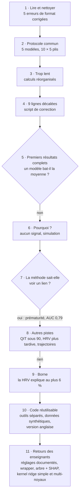

Pour chaque étape : **ce qui a été fait**, **le résultat**, et **ce qu'on en a tiré** (qui mène à l'étape suivante).

### Étape 1 · Lire et nettoyer les données

**Ce qui a été fait.** Lire les 3 exports Excel et garder, pour chaque enfant, un enregistrement de naissance (M0), les indices HRV des deux fichiers, les covariables cliniques et les 4 scores WPPSI.

**Résultat.** Cinq problèmes de format, résolus un par un :

| Problème                                                                                               | Solution                                                                                                                  |
| ------------------------------------------------------------------------------------------------------- | ------------------------------------------------------------------------------------------------------------------------- |
| identifiant introuvable : encodage Windows, en-tête WPPSI sur 2 lignes, accent illisible « Num�ro » | noms de colonnes comparés sans accents ni majuscules, « � » accepté comme joker                                      |
| une **ligne d'unités** (M/F, ms…) sous l'en-tête HRV, lue comme un enfant                      | détectée et ignorée                                                                                                    |
| `TypeError` : des cases « - » dans des colonnes de nombres                                          | les cases vides (rien, une espace, « - », « NaN ») deviennent des valeurs manquantes                                  |
| le passage de naissance écrit « MO » (lettre O) au lieu de « M0 »                                  | passages harmonisés                                                                                                      |
| des enfants dans le WPPSI mais absents des fichiers HRV                                                 | retirés ; les fichiers sont reliés par le numéro, la date de naissance sert de contrôle (les initiales se répètent) |

Jeu final : **189 enfants**, 25 indices HRV linéaires et 45 non linéaires (à M0, le fichier linéaire n'a que ses indices 24h), 6 covariables cliniques (4 trop rares retirées).

**Ce qu'on en a tiré.** Nettoyer une fois, sans jamais regarder le QI : rien de la réponse ne fuit dans le nettoyage.

### Étape 2 · Un protocole commun

**Ce qui a été fait.** Suivre le plan de la semaine et les conseils du prof : préparation dans chaque pli, sélection des variables (top 30 d'une forêt, PCA 90 %), 5 modèles (Elastic Net, Random Forest, LightGBM, XGBoost, SVR), **validation croisée 10 × 5** avec `evaluate_model.py` de l'équipe, prédiction conforme, explication.

**Ce qu'on en a tiré.** Comparer des modèles n'a de sens que sur les mêmes enfants et les mêmes plis : d'où `cohort.csv` et `folds.csv`, au format de `evaluate_model.py`, l'outil d'évaluation commun de l'équipe. Tout modèle évalué sur ces deux fichiers est directement comparable à ceux du notebook.

### Étape 3 · Trop lent

**Problème.** Les premiers lancements prenaient plus de 10 minutes en mode rapide (1 répétition au lieu de 10) : chaque combinaison de réglages essayée refaisait toute la préparation des variables.

**Ce qui a été fait.** Elastic Net calcule tout son chemin de pénalités d'un coup (`ElasticNetCV`) ; pour les modèles lents, une recherche aléatoire de 12 combinaisons remplace la grille complète (choix expliqué en section 4).

**Résultat.** Mode complet : environ 25 minutes, puis environ 40 avec les méthodes ajoutées à l'étape 11.

### Étape 4 · Neuf lignes décalées

**Ce qui a été fait.** Le contrôle des fichiers a montré **9 lignes** de `HRV_NonLineaire_Full.csv` décalées de 2 colonnes à partir de la colonne CB (les cases « vides » de fin de ligne contenaient « - »).

**Résultat.** `corriger_hrv_nonlineaire.py` les corrige : sauvegarde de l'original, aperçu avant d'écrire, refuse de tourner deux fois.

**Ce qu'on en a tiré.** Un décalage de colonnes ne provoque aucune erreur : les valeurs se retrouvent simplement sous le mauvais indice. Il faut donc contrôler les fichiers avant toute analyse. Le script de l'équipe `GroupA/clean_data.py` répare aussi ce type de lignes, mais dans ses propres copies ; le notebook lisant les fichiers d'origine, la correction est faite dans le fichier lui-même.

### Étape 5 · Premiers résultats complets : rien ne bat la moyenne

**Ce qui a été fait.** Lancement complet 10 × 5, 4 cibles, 6 expériences.

**Résultat.**

| Cible             | Meilleur modèle           | MAE   | MAE de la moyenne | Gain [IC 95 %]         |
| ----------------- | -------------------------- | ----- | ----------------- | ---------------------- |
| QIT (total)       | Elastic Net, clinique seul | 10,33 | 10,39             | +0,06 [−0,12 ; 0,23]  |
| QIV (verbal)      | Elastic Net, clinique seul | 11,68 | 11,66             | −0,02 [−0,22 ; 0,16] |
| QIP (performance) | Elastic Net, clinique seul | 9,75  | 9,75              | +0,00 [−0,16 ; 0,17]  |
| NCL (langage)     | Elastic Net, clinique seul | 11,64 | 11,62             | −0,01 [−0,15 ; 0,13] |

Aucun gain démontré (tous les IC contiennent 0). Ajouter la HRV au modèle clinique fait légèrement moins bien (MAE du QIT de 10,33 à 10,47). Les modèles à base d'arbres (Random Forest, LightGBM, XGBoost) font en moyenne moins bien que la moyenne, sur les 4 cibles.

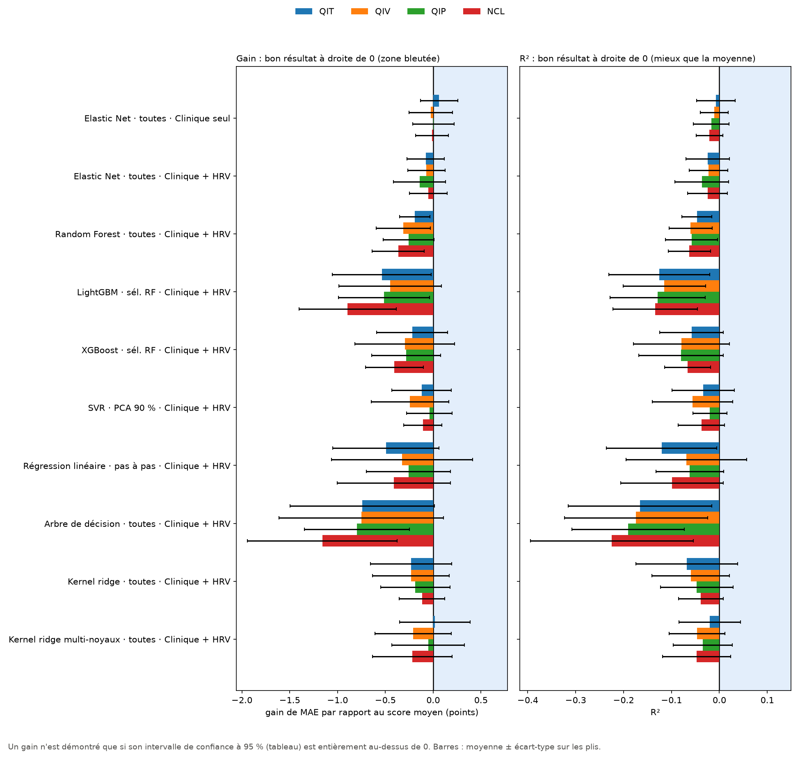

**Ce qu'on en a tiré.** Avant d'essayer d'autres modèles, comprendre pourquoi rien ne marche.

### Étape 6 · Pourquoi ? Aucun signal

**Ce qui a été fait.** (a) Comparer la plus forte corrélation entre une variable et le QIT à ce que donne le hasard. (b) Simulation : un faux QI avec un lien planté de force connue (0 à 30 % de la variance), passé par exactement la même méthode.

**Résultat.** La plus forte corrélation (0,16) n'est pas plus forte qu'avec un QI tiré au hasard (0,17 en moyenne, jusqu'à 0,21). La méthode ne détecte un lien qu'à partir d'environ **20 % de variance expliquée**.

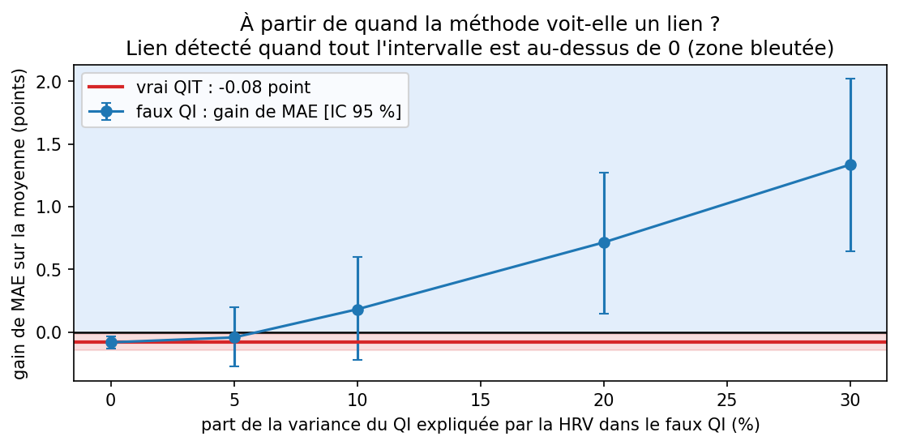

**Ce qu'on en a tiré.** Un lien plus faible (5 ou 10 %) pourrait exister sans être vu : il fallait encore vérifier la méthode, et borner le lien plus finement (étapes 7 et 9).

### Étape 7 · Contrôle positif : la HRV reconnaît la prématurité

**Ce qui a été fait.** Poser à la même méthode une question dont on connaît la réponse : deviner la prématurité à partir de la seule HRV.

**Résultat.** **AUC 0,79 [0,67 ; 0,93]** : lien démontré, discrimination acceptable, presque excellente.

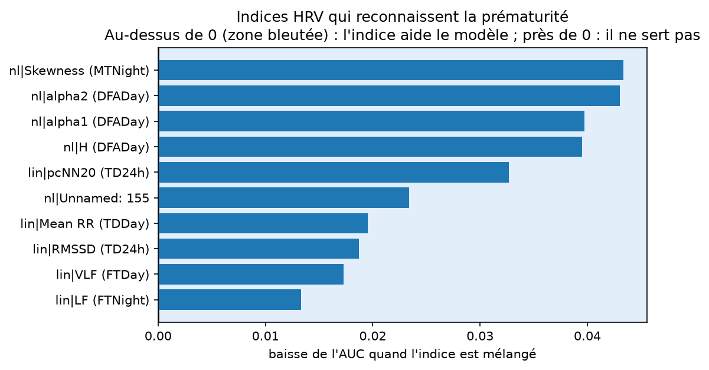

**Ce qu'on en a tiré.** Les données contiennent de l'information physiologique et la méthode sait l'extraire : l'absence de lien avec le QI est un vrai résultat, pas un problème de données ou de code.

### Étape 8 · Autres pistes

**Ce qui a été fait.** (a) Repérer les enfants avec un QIT < 90 (40 enfants) plutôt que prédire le score. (b) H1 : la HRV enregistrée plus tard (M6 à M24). (c) H2 : l'évolution de la HRV entre la naissance et 12 ou 24 mois.

**Résultat.** QIT < 90 : AUC 0,50 [0,39 ; 0,61], comme le hasard (kappa 0,02). H1 et H2 : 7 hypothèses, aucune soutenue ; deux font même moins bien que la moyenne (HRV à la naissance : gain −0,13 [−0,22 ; −0,04] ; HRV à 24 mois : −0,14 [−0,24 ; −0,05]).

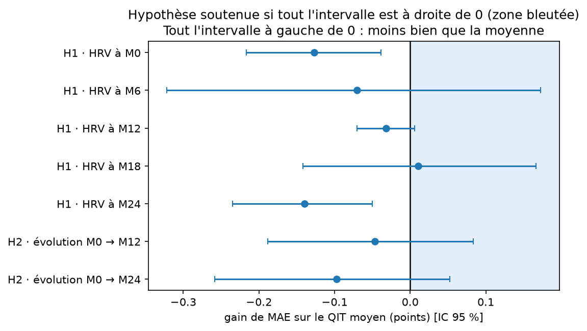

**Ce qu'on en a tiré.** Ni une question plus simple (QI bas ou non), ni une HRV plus tardive, ni son évolution ne font apparaître de lien. Plutôt que de multiplier les modèles, il fallait chiffrer ce que ce résultat permet d'exclure : quelle part du QI la HRV pourrait-elle expliquer, au plus ?

### Étape 9 · Borne : la HRV explique au plus 6 %

**Ce qui a été fait.** Au lieu de prédire avec ~70 variables, tester 4 indices choisis à l'avance d'après la littérature (RMSSD, HF, SDNN sur 24h, et la 1re composante principale de toute la HRV), avec des intervalles de confiance simultanés. Une 1re version (bootstrap) annonçait trop de faux liens (6,3 % sur 300 jeux simulés, au lieu de 5 % au plus) ; elle a été remplacée par l'intervalle de Fisher, vérifié sur 8 000 jeux simulés.

**Résultat.** Aucun lien démontré ; aucun de ces indices n'explique **plus de 6 %** de la variance du QIT, avant comme après prise en compte des covariables cliniques. Un lien de 6 % aurait été détecté 8 fois sur 10.

| Limites de détection                                | Vérification du test                                      | Bornes                        |
| ---------------------------------------------------- | ---------------------------------------------------------- | ----------------------------- |
| 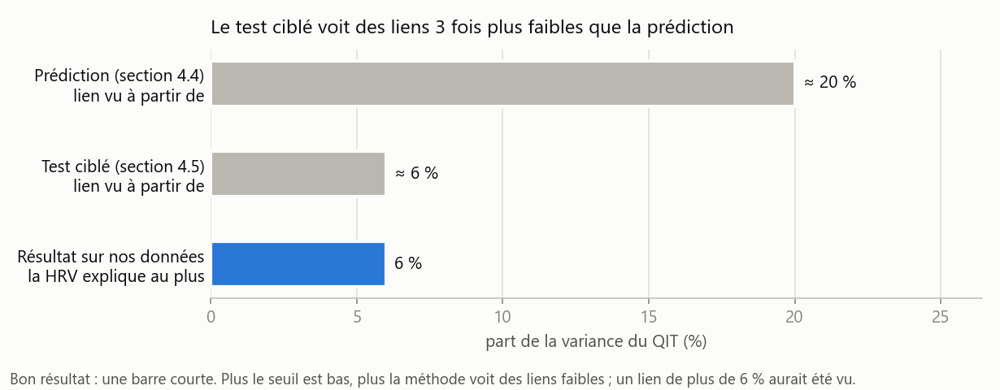 | 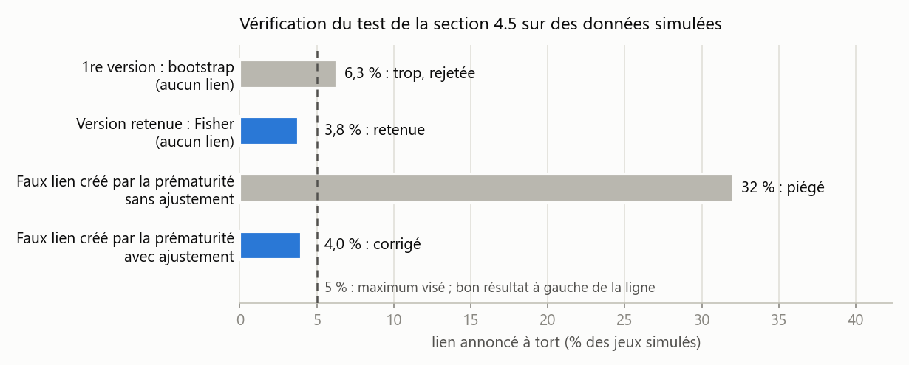 | 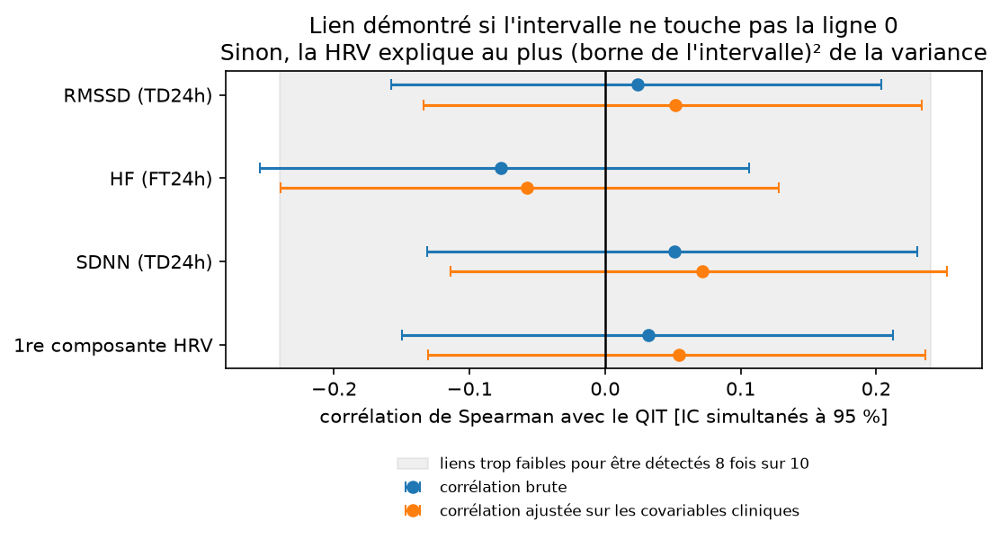 |

**Ce qu'on en a tiré.** « On n'a rien vu » est devenu « au plus 6 % », une affirmation bien plus forte.

### Étape 10 · Rendre le code réutilisable

**Ce qui a été fait.** Le code technique (lecture, nettoyage, modèles, graphiques) a été sorti du notebook et rangé dans `outils_qit.py`, par section : le notebook ne montre plus que les étapes et les résultats. Les méthodes n'ont pas changé, et les chiffres ont été vérifiés identiques avant et après. Pour que d'autres puissent reprendre le travail : une version anglaise du notebook (mêmes calculs, mêmes chiffres), un générateur de données synthétiques pour essayer le code sans les vraies données, un moyen de tester n'importe quel modèle scikit-learn avec le même protocole (section 6), et les graphiques agrégés enregistrés dans `results/`.

**Résultat.** Les versions des bibliothèques comptent. Dans un environnement neuf installé depuis `requirements.txt` (versions plus récentes que celles du développement), Elastic Net, Random Forest, XGBoost et SVR redonnent les mêmes prédictions, aux arrondis de calcul près ; **LightGBM** non (sur les données synthétiques, jusqu'à 12 points d'écart pour un enfant). LightGBM n'est jamais le meilleur modèle : la conclusion ne change pas.

**Ce qu'on en a tiré.** Les versions sont fixées dans `requirements.txt`, et un résultat se compare toujours à un autre obtenu avec les mêmes versions.

### Étape 11 · Retours des enseignants

**Ce qui a été fait.**

| Demande                                                                                                | Ce qui a été fait                                                                                                                                                                                                                                                                        | Vérifications                                                                                                                                                                                                                                              |
| ------------------------------------------------------------------------------------------------------ | ------------------------------------------------------------------------------------------------------------------------------------------------------------------------------------------------------------------------------------------------------------------------------------------ | ----------------------------------------------------------------------------------------------------------------------------------------------------------------------------------------------------------------------------------------------------------- |
| Dire si les paramètres sont ceux par défaut, sinon lesquels et comment ils ont été trouvés        | deux tableaux automatiques (section 4), réglages retenus pli par pli                                                                                                                                                                                                                      | en vérifiant, la **grille du SVR avait des doublons** (`gamma` ne sert pas au noyau linéaire : 12 des 48 combinaisons) ; séparée en deux espaces. Seuls les chiffres du SVR changent ; tous les autres modèles redonnent exactement les mêmes |
| Tester une méthode **wrapper**                                                                  | sélection **pas à pas** (forward) avec une régression linéaire, dans chaque pli                                                                                                                                                                                                  | nombre de variables gardées et les plus choisies affichés                                                                                                                                                                                                 |
| **Arbre de décision** avec **SHAP**, et avec l'importance des variables, pour les classer | arbre comme 10e modèle ; classement par importance d'impureté et par SHAP, avec sa **stabilité** et des **seuils du hasard** (même classement avec le QI mélangé) ; graphiques SHAP : essaim (individuel, jamais enregistré) et **effet par quintile** (agrégé) | additivité de SHAP vérifiée (contributions + base = prédiction)                                                                                                                                                                                         |
| **Kernel ridge regression** et **multiple kernel ridge regression**                        | kernel ridge avec le QI centré-réduit dans chaque pli (pas de constante) ; multi-noyaux écrit pour le projet (`RidgeMultiNoyaux`) : un noyau gaussien par groupe (clinique, HRV linéaire, HRV non linéaire), poids choisis par validation croisée interne                          | avec un seul groupe, il redonne exactement le kernel ridge de scikit-learn                                                                                                                                                                                  |

**Résultat** (QIT, 10 × 5 plis ; détail dans [`results/SUMMARY.md`](results/SUMMARY.md)) :

| Modèle (Clinique + HRV)                     | MAE   | Gain sur la moyenne [IC 95 %] | Lecture                                                 |
| -------------------------------------------- | ----- | ----------------------------- | ------------------------------------------------------- |
| Régression linéaire, sélection pas à pas | 10,89 | −0,50 [−0,75 ; −0,24]      | moins bien que la moyenne (tout l'IC sous 0)            |
| Arbre de décision                           | 11,14 | −0,74 [−1,03 ; −0,46]      | moins bien que la moyenne                               |
| Kernel ridge                                 | 10,62 | −0,23 [−0,37 ; −0,09]      | moins bien que la moyenne                               |
| Kernel ridge multi-noyaux                    | 10,38 | +0,02 [−0,30 ; 0,32]         | non démontré : fait jeu égal avec la moyenne (10,39) |

- **Poids du multi-noyaux** (médiane sur les 50 plis) : clinique **1,00**, HRV linéaire **0,00**, HRV non linéaire **0,00**. Quand on la laisse choisir, la validation croisée **n'utilise pas du tout la HRV** : c'est pour ça que ce modèle rejoint la moyenne au lieu de faire moins bien.
- **Classement des variables** : l'accord des top 5 entre plis vaut 0,08 pour le QIT (le classement change presque à chaque pli) et 0,22 pour la prématurité (plus stable ; variable en tête : `nl|alpha2 (DFADay)`, un indice fractal de la HRV de jour). Pour savoir si ces valeurs sont bonnes, tout le classement est refait avec le QI (ou la prématurité) mélangé entre enfants : les seuils du hasard ainsi obtenus sont tracés sur les graphiques ci-dessous et repris dans `results/SUMMARY.md`.
- **SVR** : ses chiffres changent un peu avec la grille corrigée (tableau de tous les modèles dans `results/SUMMARY.md`) ; il reste moins bon qu'Elastic Net.
- Réglages retenus pli par pli : [`results/reglages_retenus_QIT.md`](results/reglages_retenus_QIT.md).

**Ce qu'on en a tiré.** Quatre méthodes de plus confirment la conclusion : aucune ne fait mieux que la moyenne, trois font moins bien, et le seul modèle qui pouvait choisir entre la clinique et la HRV écarte la HRV.

| Classement pour le QIT                        | Classement pour la prématurité                                |
| --------------------------------------------- | --------------------------------------------------------------- |
| 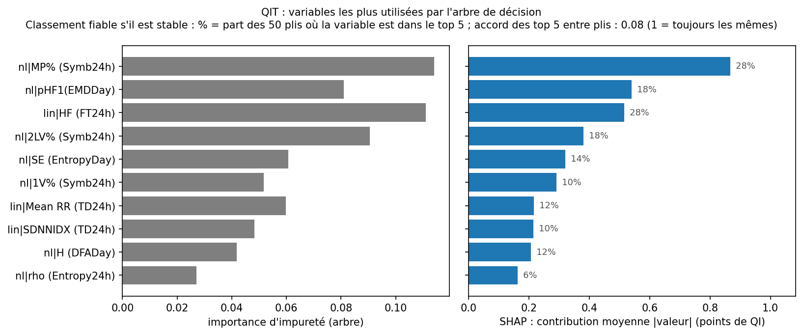 | 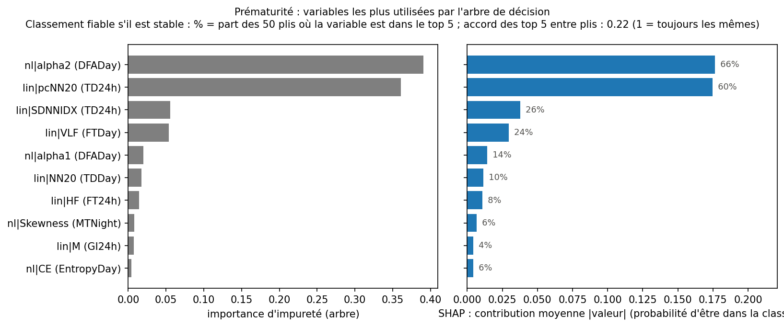 |

| Effets SHAP pour le QIT                         | Effets SHAP pour la prématurité                                 |
| ----------------------------------------------- | ----------------------------------------------------------------- |
| 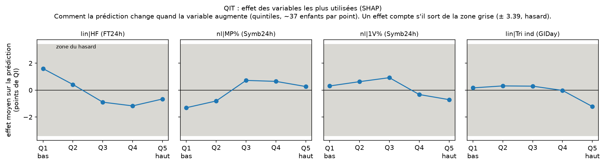 | 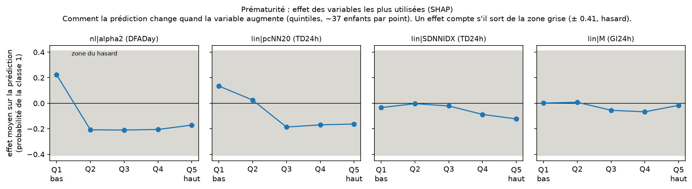 |

---

## 6. Réutiliser le code

### Essayer sans les vraies données

Dans les réglages du notebook : `DONNEES_SYNTHETIQUES = True`. Le notebook crée de fausses données dans `data/synthetique/` (mêmes colonnes, mêmes pièges de format que les vrais fichiers, valeurs tirées au hasard) et tout tourne de bout en bout. Les résultats vont dans `data/synthetique/results/` : ils n'écrasent pas les vrais, et le résumé porte la mention « DONNÉES SYNTHÉTIQUES ». Deux liens sont plantés exprès dans ces fausses données (HRV → prématurité, fort ; HRV → QI, faible) pour que les analyses aient quelque chose à trouver.

### Tester son propre modèle

N'importe quel modèle scikit-learn passe par exactement le même protocole que les autres : mêmes enfants, mêmes plis, préparation des variables refaite dans chaque pli, évaluation par `evaluate_model.py`. Dans la section 3 du notebook :

```python
from sklearn.linear_model import Ridge
MODELES_PERSO = {"Ridge": Ridge(alpha=10)}
EXPERIENCES = [
    ("Elastic Net", "toutes", "Clinique seul"),       # la référence clinique, à garder
    ("Ridge", "toutes", "Clinique + HRV"),            # le nouveau modèle
    # sélections possibles : "toutes", "sél. RF", "PCA 90 %", "pas à pas"
    # jeux de variables : "Clinique seul", "HRV seule", "Clinique + HRV"
    # modèles déjà prêts : "Elastic Net", "Random Forest", "LightGBM", "XGBoost", "SVR", "Régression linéaire",
    #                      "Arbre de décision", "Kernel ridge", "Kernel ridge multi-noyaux"
]
```

Le modèle est copié neuf dans chaque pli. Pour régler ses hyperparamètres sans fuite, donner un objet qui se règle lui-même (`RidgeCV`, `GridSearchCV(...)`, `RandomizedSearchCV(...)`).

### Adapter à d'autres données

Les réglages à changer sont marqués `[À ADAPTER]` dans le notebook et en tête de `outils_qit.py`.

| Je veux…                                     | Où                           | Quoi changer                                                                                              |
| --------------------------------------------- | ----------------------------- | --------------------------------------------------------------------------------------------------------- |
| d'autres fichiers                             | réglages du notebook         | `FICHIERS`                                                                                              |
| d'autres noms de colonnes                     | en tête de `outils_qit.py` | `COL_ID_HRV`, `COL_ID_WPPSI`, `COL_PASSAGE`, `COLS_SCORES`, `COLS_CLINIQUES`, `MOTIFS_EXCLUS` |
| prédire d'autres scores                      | réglages du notebook         | `CIBLES` (parmi `COLS_SCORES`) ; les sections 4.3 à 10 détaillent le QIT                            |
| d'autres seuils de nettoyage ou de sélection | en tête de `outils_qit.py` | `SEUIL_CORR`, `TOP_K`, `VARIANCE_PCA`, `TOL_PAS_A_PAS`, `MAX_MANQUANTS_COL`…                   |
| d'autres hyperparamètres                     | `outils_qit.py`             | `ESPACES`                                                                                               |
| plus ou moins de répétitions                | réglages du notebook         | `T_REPETITIONS`, `K_PLIS`, `N_ITER`                                                                 |
| d'autres indices pour la borne (4.5)          | réglages du notebook         | `INDICES_A_PRIORI`, à fixer **avant** de voir les résultats                                     |

### Utiliser les outils dans son propre notebook

Après un premier lancement du notebook, qui crée `cohort.csv` et `folds.csv` dans `data/cleaned/` :

```python
import sys
from pathlib import Path
RACINE = Path("../..").resolve()                     # le dossier qui contient evaluate_model.py
sys.path[:0] = [str(RACINE), str(RACINE / "GroupA" / "Jade")]
import outils_qit as outils
from evaluate_model import load_labels
from sklearn.linear_model import Ridge

sources = outils.charger(RACINE / "data", {"lin": "HRV_Lineaire_Full.csv", "nl": "HRV_NonLineaire_Full.csv",
                                           "wppsi": "Résultats WPPSI III.csv"})
donnees = outils.construire_donnees(sources, "M0")            # un enregistrement par enfant à la naissance
plis = outils.plis_communs(RACINE / "data" / "cleaned" / "folds.csv", range(1, 11))
y = load_labels(RACINE / "data" / "cleaned" / "cohort.csv", ["QIT"]).loc[donnees.index, "QIT"]
X = donnees.filter(regex=r"^(lin|nl|clin)\|")                 # indices HRV et covariables cliniques
P = outils.predictions_croisees(X, y, plis, Ridge(alpha=10))  # prédictions hors pli
print(outils.gain_vs_moyenne(y, P, plis))                     # gain sur la moyenne et son IC 95 %
```

Chaque fonction a une explication (`help(outils.predictions_croisees)`) et un nom anglais (`outils.cross_predictions`, liste en fin de `outils_qit.py`).

### Trois règles à garder

1. **Tout ce qui apprend se fait dans les plis**, sur les seuls enfants d'entraînement : imputation, sélection, réglage, modèle. C'est ce que fait `faire_pipeline` ; ne pas préparer les variables sur tous les enfants avant la validation croisée.
2. **Ne jamais mettre les scores WPPSI (ni leurs sous-tests) dans les variables d'entrée** : ils contiennent la réponse (voir [Pièges](#7-pièges-à-éviter)).
3. **Ne jamais enregistrer ni partager les graphiques individuels** (sections 4.3 et 8, et l'essaim SHAP de la section 9). Seuls les graphiques agrégés sont enregistrés dans `results/`.

---

## 7. Pièges à éviter

- **Fuite de la cible** : mettre les sous-tests WPPSI, le QIV ou le QIP parmi les variables pour prédire le QIT donne un R² proche de 1, parce que le QIT est calculé à partir d'eux. Un résultat trop beau doit faire chercher une fuite.
- **Choisir les variables sur tous les enfants** avant la validation croisée : les enfants de test « aident » à préparer le modèle, le score est trop optimiste.
- **Rapporter le score de réglage** (`best_score_` d'une recherche d'hyperparamètres) comme performance : il est optimiste par construction. Il faut une validation croisée imbriquée.
- **L'exactitude avec des classes déséquilibrées** : avec 79 % d'enfants au-dessus de 90, répondre toujours « ≥ 90 » donne 79 % d'exactitude sans rien savoir. Regarder l'AUC, la sensibilité, l'exactitude équilibrée, le kappa.
- **Les comparaisons multiples** : sur 7 hypothèses, une réussite isolée peut venir du hasard.
- **Choisir après coup** les indices « à priori » de la section 4.5 : le test perdrait sa validité.
- **Croire un classement de variables sans son seuil du hasard ni sa stabilité** : un arbre désigne toujours une variable en tête, même quand il n'y a aucun signal.
- **Une grille de réglages mal construite** : un paramètre qui ne sert qu'avec une option (comme `gamma` pour le noyau `rbf`) crée des combinaisons en double ; il faut des espaces séparés. Et un modèle sans constante (kernel ridge) a besoin d'un QI centré.
- **Les identifiants** : les initiales et la date de naissance ne suffisent pas (elles se répètent) ; relier par le numéro.
- **Les cases vides** s'écrivent de quatre façons dans ces fichiers : rien, une espace, « - » ou « NaN ».
- **nbstripout** n'est pas dans le dépôt : `nbstripout --install` sur chaque clone, avant le premier commit.
- **Les versions des bibliothèques** : installer `requirements.txt` partout ; LightGBM peut changer de prédictions d'une version à l'autre.

---

## 8. Reprendre le travail

**Où on en est**

| Fait et solide | Pas encore fait |
| --- | --- |
| nettoyage, protocole commun, 10 modèles, contrôle positif, classification, hypothèses H1/H2, borne, prédiction conforme, réglages documentés, méthodes demandées par les enseignants (wrapper, arbre + SHAP avec seuils du hasard, kernel ridge simple et multi-noyaux) | variables tirées des données brutes (fichiers RR, signal ECG) : travail du groupe B ; validation sur une autre cohorte |

**Suites possibles**, de la plus à la moins prometteuse :

1. **Brancher les variables du groupe B** (tirées des données brutes RR / ECG) : les ajouter comme colonnes avec leur propre préfixe (par exemple `brut|`) dans `construire_donnees`, puis comme nouveau jeu dans `JEUX` ; tout le reste (plis, modèles, évaluation, classement) fonctionne sans changement, sauf le kernel ridge multi-noyaux, dont les groupes sont fixés dans `RidgeMultiNoyaux.GROUPES` (y ajouter le nouveau préfixe, sinon ces variables y sont ignorées).
2. **Confirmer sur une autre cohorte** tout lien qui apparaîtrait ; avec ~190 enfants, rien ne peut être confirmé en interne.
3. **Un test de dépendance non linéaire** en section 4.5 (corrélation de distance avec un test par permutation), pour exclure un lien en U que Spearman raterait ; les arbres et les noyaux rbf ont déjà cherché des liens non linéaires sans en trouver.
4. **Le Lasso pur** (`l1_ratio = 1`) : Elastic Net essaie déjà des mélanges très proches (`l1_ratio` jusqu'à 0,9) sans faire mieux que la moyenne, donc on n'en attend pas d'autre conclusion ; c'est en revanche l'essai le plus simple à ajouter (un `LassoCV` dans `MODELES_PERSO`, section 6).

**À savoir avant de modifier** : après une modification de `outils_qit.py`, redémarrer le noyau du notebook ; vérifier d'abord tout changement sur les données synthétiques (`DONNEES_SYNTHETIQUES = True`) ; un lancement complet prend environ 40 minutes.

---

## 9. Limites

- Environ 190 enfants, une seule cohorte, pas de validation externe.
- Le QI à 3 ans dépend de beaucoup de choses absentes ici (environnement familial, niveau socio-économique, événements des premières années).
- Une association n'est pas une cause : un modèle prédictif ne dit pas comment améliorer le QI d'un enfant.
